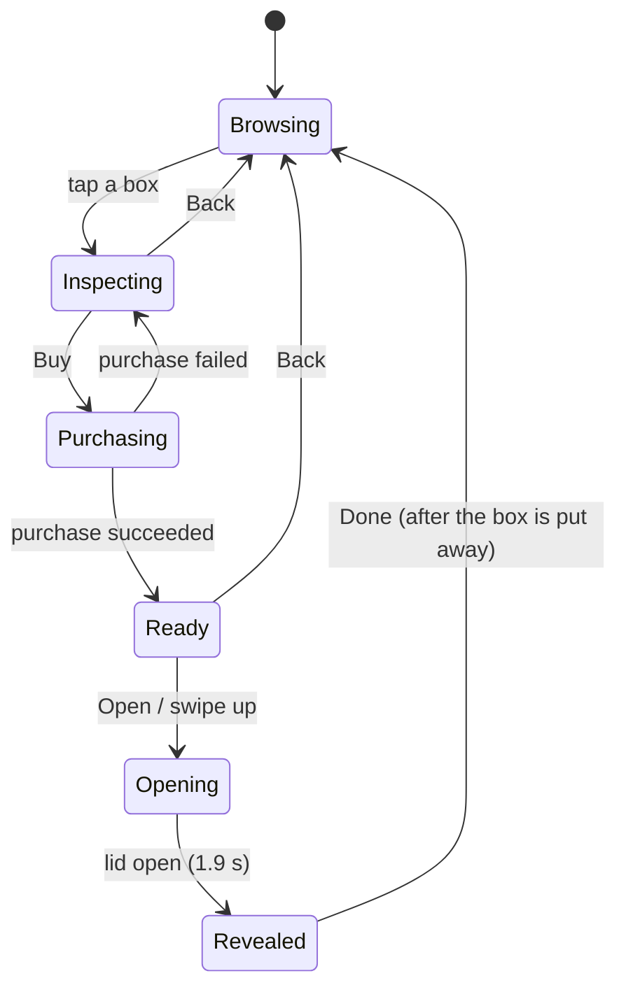
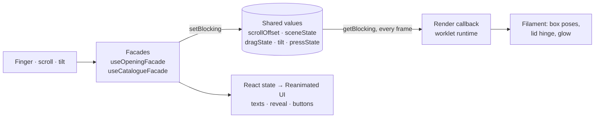
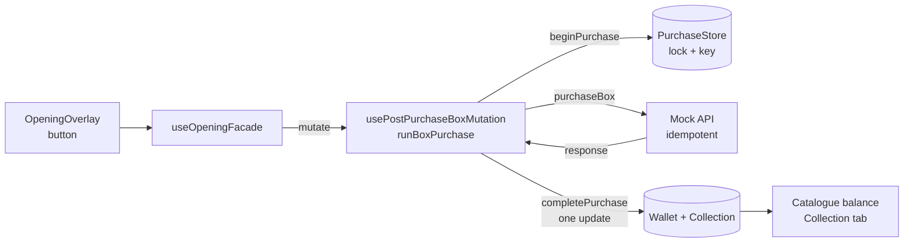

# `Mystery Watch` - React Native Proof of Concept

[](https://expo.dev/)
[](https://reactnative.dev/)
[](https://www.typescriptlang.org/)
[](https://google.github.io/filament/)
[](https://docs.swmansion.com/react-native-reanimated/)
[](https://zustand-demo.pmnd.rs/)
[](https://tanstack.com/query/latest)

> **Documentation map:** [docs/README.md](docs/README.md) · **how to test:** [docs/TESTING.md](docs/TESTING.md) · **animations:** [docs/ANIMATIONS.md](docs/ANIMATIONS.md) · **test results:** [docs/TEST_CHECKLIST.md](docs/TEST_CHECKLIST.md) · **FPS:** [docs/PERFORMANCE.md](docs/PERFORMANCE.md)
>
> **One rule above all:** test on **one platform at a time**. Either the Android emulator with the iOS simulator shut down, or the iOS simulator with the Android emulator shut down. They share the Mac's GPU and CPU; with both open you get false jank and useless FPS numbers ([why and how to switch](docs/TESTING.md#rule-1--one-platform-at-a-time)).

## Table of Contents

1. [Introduction](#1-introduction)
2. [Quick Start](#2-quick-start)
3. [The App](#3-the-app)
4. [Project Architecture](#4-project-architecture)
5. [Real-time 3D](#5-real-time-3d)
6. [Vendored Filament](#6-vendored-filament)
7. [Quality Gates and Tests](#7-quality-gates-and-tests)
8. [Performance](#8-performance)
9. [Project Structure](#9-project-structure)
10. [Roadmap & Status](#10-roadmap--status)
11. [Known Limits and Decisions](#11-known-limits-and-decisions)
12. [Troubleshooting](#12-troubleshooting)

---

## 1. Introduction

**Project Overview:**
Mystery Watch is a proof of concept for discovering, buying and opening mystery boxes that contain watches. A scrollable catalogue shows **real-time rendered 3D boxes**, you tap one to **inspect it with your finger and open it** with an animated lid and a reveal, a virtual balance pays for it, and the watches you win go into your collection. The assignment is in [docs/ASSIGNMENT.md](docs/ASSIGNMENT.md).

The code base follows the conventions of an enterprise React Native app: feature-based **flows**, logic-less UI, **facades** for business logic, **adapters** for data mapping, Zustand for client state and React Query for async (mock-API) state.

**Definition of done — all met on iOS and Android:**
- the full flow works: browse → inspect → buy → open → reveal → collection
- every successful purchase makes **exactly one balance deduction and one watch** (also under repeated taps and lost responses)
- a failed purchase **changes nothing** (balance and collection stay the same) and can be retried
- the 3D scene holds **60 FPS** while scrolling, turning and opening

**Key Features:**

- 🧊 Real-time 3D with **Google Filament** (Metal on iOS, OpenGL ES on Android), driven from worklets
- 🎯 **One shared 3D scene** for the whole app — the same box models are in the list and in the opening screen
- 🔩 Exact **hinge kinematics** for the lid and wordmark (pivot `[0, 0.914876, 0.359181]`, 0° → 115°)
- ✋ **Inspect with your fingers:** drag with inertia, pinch to zoom, double tap to reset, swipe up to open, device tilt; anticipation shake, animated lid with light from inside, rarity-based reveal (Common → Legendary), sounds and haptics
- 💸 Purchase with an **exactly-once guarantee** (idempotency keys, atomic state update, lock against repeated taps)
- 🏗️ Feature-based (flows) architecture, facades, adapters, typed navigation
- 🔄 Zustand (session-scoped, no persistence) + React Query over an asynchronous mock API with a failure switch
- 🧪 Jest + React Native Testing Library, ESLint 9 + Prettier, `ciPipeline`
- 📦 **Vendored** 3D dependency with a reproducible binary installer — builds on a clean machine
- ✨ A full set of animations (push-in, anticipation, rarity reveal, gestures, sound) described with screenshots in [docs/ANIMATIONS.md](docs/ANIMATIONS.md)
- 📊 Reproducible performance tooling and a plain-English [performance report](docs/PERFORMANCE.md)

**Tech Stack:**

| Area | Choice |
|---|---|
| Framework | Expo SDK 58, React Native 0.88.1 (new architecture), React 19.3 |
| Language | TypeScript 6.0 (strict) |
| 3D | `react-native-filament` 2.0.0-rc.6 (vendored) |
| Animation / gestures | Reanimated 4.7 + `react-native-worklets` 0.13, Gesture Handler 3, Haptics |
| State | Zustand 5 (client), TanStack Query 5 (mock API) |
| Navigation | React Navigation 7 (bottom tabs) |
| Lists | FlashList 2 |
| i18n | i18next 27 |
| Tests | Jest 30 + React Native Testing Library 14 |
| Quality | ESLint 9 (flat) + Prettier 3, `expo-doctor` |

---

## 2. Quick Start

### Prerequisites

- macOS with **Xcode 27** and an iOS Simulator (Xcode 27 requires Expo SDK 58+)
- **Android Studio**, JDK 17, an AVD with **≥ 4 cores, ≥ 4 GB RAM, `hw.gpu.mode=host`**
- Node 24+ (developed on Node 26), yarn classic 1.22 (`corepack enable`), CocoaPods, watchman
- `export LANG=en_US.UTF-8` (CocoaPods needs a UTF-8 locale)

### Installation and first run

```bash
git clone https://github.com/GoRRRuslan/boxConceptOfProof-1
cd boxConceptOfProof-1

# Install dependencies. The postinstall hook downloads the Filament native
# binaries once (~90 MB archive, cached in .cache/filament) into node_modules.
yarn install

# Generate the native projects
yarn iosPrebuild
yarn androidPrebuild

# Build and install the development client, then start Metro
yarn iosRun            # iPhone simulator
yarn androidRun        # Android emulator / device
yarn start
```

> Expo Go cannot run Filament — the app is a **development build** (`expo-dev-client`).

### Just try it (recommended for reviewers)

A release build carries its JavaScript inside the app, so it needs no Metro server and no dev client. After `yarn install` and the prebuild commands above:

```bash
# Android: start any emulator (Android Studio, or: $ANDROID_HOME/emulator/emulator -avd <name> -gpu host), then
yarn androidRunRelease

# iOS: with a simulator booted
yarn iosRunRelease
```

> **Only one device at a time.** Before you start the Android emulator shut the iOS simulator down (`xcrun simctl shutdown all`), and the other way round (`adb emu kill`). Both at once give choppy frames that have nothing to do with the app. More: [docs/TESTING.md](docs/TESTING.md).

What to expect: scroll the list, tap a box, drag / pinch / double-tap it, buy it, swipe up (or tap *Open the box*), watch the reveal, then look at *Collection*. Each successful purchase costs exactly once and adds exactly one watch.

About smoothness: the app renders at a steady 60 FPS on both platforms (see [Performance](#8-performance)). The Android emulator **window** was measured too, with the finished app, while the list was scrolled non-stop: **60 FPS for 30 s, twice (1800 frames each)**, at the default size and at `-scale 0.6 / 0.7 / 0.85 / 1.0`. Two things matter: use an AVD with at least 4 cores, 4 GB RAM and `hw.gpu.mode=host`, and give a freshly booted emulator a minute to finish its post-boot work (right after boot we once saw 43 FPS, which went away on its own). If the window ever feels slow, restart it with `emulator -avd <name> -gpu host -scale 0.7`; for exact measurements use the headless start (`yarn androidEmulatorStart`).

### Run the quality gates

```bash
yarn ciPipeline   # ESLint + TypeScript
yarn test         # Jest + React Native Testing Library
```

### Release builds (what the performance numbers use)

> Run **one platform at a time** (iOS simulator **or** Android emulator, the other shut down): they share the Mac's GPU and CPU. See [docs/TESTING.md](docs/TESTING.md#2-the-golden-rules).

```bash
yarn androidEmulatorStart                 # Android emulator, headless (needed for correct FPS)
yarn androidRunOpening                    # release build with the FPS overlay
yarn iosRunOpening --device "iPhone 17"   # same on iOS
```

### Scripts

| Script | What it does |
|---|---|
| `yarn start` | Metro for the development client |
| `yarn iosPrebuild` / `yarn androidPrebuild` | Clean native project generation (`expo prebuild --clean`) |
| `yarn iosRun` / `yarn androidRun` | Build and install the development client |
| `yarn ciPipeline` | **ESLint + TypeScript** (the gate for every change) |
| `yarn test` | Jest + RNTL |
| `yarn doctor` | `expo-doctor` health check |
| `yarn adbR` | `adb reverse tcp:8081 tcp:8081` |
| `yarn cleanNative` / `cleanCache` / `cleanNode` / `watchman` | Reset helpers |
| `yarn iosRestart` / `yarn androidRestart` / `yarn androidRestartRelease` | Relaunch the installed app without rebuilding |

The performance scripts are listed in [Performance](#8-performance).

---

## 3. The App

Two tabs: **Boxes** and **Collection**.

| Browse | Inspect | Reveal | Collection |
|---|---|---|---|
|  |  |  |  |

1. **Browse (Boxes tab).** Eight boxes at different prices, each a live 3D model with its own colour and a finish that gets glossier with the price. The card shows the price and the best possible prize; a box the balance cannot pay for says "Not enough balance". The balance is in the header and counts to its new value when it changes.
2. **Inspect.** Tap a box: it flies to the middle of the screen with a small push towards the camera. Drag to turn it (it keeps turning after you let go), pinch to zoom, double tap to reset; left alone it turns slowly by itself and leans with the phone. **Back** is in the top left corner, the box name and price are centred below it.
3. **Buy.** One button. While the purchase runs the button is disabled and you cannot leave. On success the balance drops by the price and the watch is yours; on failure you see why ("Nothing was charged") and can try again.
4. **Open.** Press the button or swipe up. The box shakes and swells (anticipation), the lid swings open about its hinge and a light of the prize's colour shines from inside.
5. **Reveal.** A rarity pill (Common, Rare, Epic, Legendary!), the watch in two glowing circles, a flash and particles for the better prizes, then the price, name and brand. After a moment the opened box is put away; only then does **Done** appear. While a prize is shown the tab bar is invisible. **Done** returns to the list.
6. **Collection tab.** Your watches, newest first, with the total value; tap a row for a large picture; an empty state with a "Browse boxes" button when you have none. A restart starts a new session (nothing is persisted, as required).

Detailed write-ups with screenshots: [animations](docs/ANIMATIONS.md) · [Stage 2 domain](docs/STAGE_2_DOMAIN.md) · [Stage 3 catalogue](docs/STAGE_3_CATALOGUE.md) · [Stage 4 opening (first version)](docs/STAGE_4_OPENING.md) · [Stage 5 collection](docs/STAGE_5_COLLECTION.md) · [test checklist](docs/TEST_CHECKLIST.md).

### The phases of one box



Pure and unit-tested: [`openingPhaseMachine.ts`](src/flows/openingFlow/_facadesLogic/openingPhaseMachine.ts). An event that does not belong to the current phase is ignored, so a double tap or a late result can never push the flow into a wrong state.

### The purchase guarantee

Balance and collection change in **one place** — `PurchaseStore.completePurchase` — in a single state update, only when the API succeeded, the response belongs to the running purchase and its idempotency key was not applied before.

| Case | Result |
|---|---|
| Success | one deduction + one watch |
| Not enough balance | refused before the API; nothing changes |
| Network / server error | nothing changes; the next purchase is unlocked |
| Repeated taps while a purchase runs | extra taps ignored (synchronous lock), the API is called once |
| Response lost (server did process it) | the retry re-uses the idempotency key → same watch, still **one** deduction |

The mock API (`src/networking/api/MysteryBoxApi`) is asynchronous (700 ms), idempotent per key, and has a failure switch: `EXPO_PUBLIC_MOCK_PURCHASE_FAILURE=networkError | serverError | responseLost` (or `mockApiSettings` in code and tests). The prize is rolled deterministically from the purchase key, so a retry can never become a different watch.

---

## 4. Project Architecture

### Core Principles

1. **Feature-Based (flows) Architecture:** code is organised by business feature, not by technical layer
2. **Logic-less UI:** screens and components render; every piece of logic sits in a facade (`_facades`) or a pure function (`_facadesLogic`)
3. **Separation of Concerns:** UI → facade → adapters/stores/queries → services
4. **Typed everywhere:** strict TypeScript, facade return types live in `_types/`
5. **Testability:** business logic is in hooks and pure functions that are unit-tested without rendering
6. **The 3D thread never waits for React:** React writes small shared values, the render thread reads them every frame

### Architecture Layers

```
┌─────────────────────────────────────────────┐
│ Presentation   screens · components · styles │  render only
├─────────────────────────────────────────────┤
│ Business logic facades (use…Facade)          │  state, handlers, effects
│                _facadesLogic (pure functions)│  maths, rules, easing
├─────────────────────────────────────────────┤
│ Data           adapters · Zustand · React    │  mapping, session state,
│                Query over the mock API       │  async (mock) API
├─────────────────────────────────────────────┤
│ Services       animation · sounds · haptics  │  one job each, no UI
│                filament · performance        │
├─────────────────────────────────────────────┤
│ Rendering      Filament scene · worklet      │  per-frame 3D
│                runtime (render callback)     │
├─────────────────────────────────────────────┤
│ Navigation     tab navigator                 │
├─────────────────────────────────────────────┤
│ Platform       Expo / React Native           │
└─────────────────────────────────────────────┘
```

### Inside a flow

```
flows/<name>Flow/
├── _adapters/      map API/store data to what a screen shows (pure, useMemo)
├── _config/        numbers and constants of the feature (timings, sizes, rarity styles)
├── _facades/       useXxxFacade: translations → navigation → state → store → queries → adapter → values → handlers → effects
├── _facadesLogic/  pure functions (also run on the worklet runtime, so each carries the 'worklet' directive)
├── _types/         facade return types and shared interfaces
└── screens/<Screen>/
    ├── <Screen>.tsx · .styles.ts · index.ts
    ├── _components/<Part>/   a part with its own _facades/ when it needs logic or animation
    └── __tests__/
```

### The three flows

| Flow | Owns | Key files |
|---|---|---|
| `catalogueFlow` | The list, the one shared 3D scene, box poses, finishes, lights, entrance and press animations, the balance | `useCatalogueFacade`, `useFacadeCatalogueBoxes` (the per-frame callback), `computeBoxPose`, `sceneRenderConfig` |
| `openingFlow` | The phases, buying, gestures, anticipation, lid, glow, reveal, putting the box away, haptics, sounds | `useOpeningFacade`, `openingPhaseMachine`, `openingSceneState`, `computeOpeningPose`, `stepDragInertia`, `rarityConfig`, `OpeningOverlay` |
| `collectionFlow` | The collection tab, its rows, the detail sheet, the total value | `useCollectionFacade`, `useAdapterCollectionItems`, `CollectionDetailModal` |

`spikeFlow` is the benchmark lab (`EXPO_PUBLIC_INITIAL_SCREEN=spike`), not part of the app.

### How React talks to the 3D thread



- React only **writes** small values (scroll offset, which box is open and when each animation started, drag, tilt, press). The render callback **reads** them before every frame and computes poses, lid angle and glow itself.
- Animations in the scene are **time-based** from a start timestamp (see `computeAnimatedProgress`), so React never has to tick.
- Every helper called from the render callback must itself carry the `'worklet'` directive; otherwise the app fails at runtime with "Tried to synchronously call a Remote Function" (Jest cannot catch this, so it is checked on a device).

### Data flow of a purchase



### Timers of an opening

`useOpeningFacade` keeps every timer of an opening in one list (`openingTimers`): the lid sound, the reveal, the box being put away, and the moment the renderer may rest. They are all cancelled by **Back/Done**, by selecting another box and on unmount, so a late timer can never act on the next box.

### Conventions (enforced by ESLint and `CLAUDE.md`)

- No abbreviations in names; English only in code
- No hard-coded visible strings — everything through `t()`
- No logic in UI files; no fallback substitution (guard → warn → return)
- Facade sections in strict order: translations → navigation → state → store → queries/mutations → adapters → values → handlers → effects
- `FlashList` for lists, `testID` on every interactive element, no inline styles or colour literals (colours live in `utils/designSystem/Theme.ts`)
- Path aliases: `@app`, `@flows`, `@components`, `@models`, `@networking`, `@services`, `@utils`, `@assets`, `@i18next`, `@configs`, `@navigation`

---

## 5. Real-time 3D

### One scene for the whole app

Each `<FilamentScene>` creates its own Filament engine, and the library is built for **one engine per app**. On Android a second scene never draws. The catalogue is therefore one scene behind a list of transparent cards, and the opening experience reuses the same box instances.

```
┌──────────────── FlashList (transparent cards) ────────────────┐
│  name · price · prize         ← React Native views            │
├───────────────────────────────────────────────────────────────┤
│  ONE FilamentScene (behind the list)                          │
│   box #1   box #2   box #3 …   ← one GLB, instanced           │
└───────────────────────────────────────────────────────────────┘
        ▲ every frame: pose of each box = f(scroll offset, opening state)
```

- On every scroll event the offset is written into a shared value; right before each frame the 3D side reads it and places every box in its card's slot ([`computeBoxPose`](src/flows/catalogueFlow/_facadesLogic/computeBoxPose.ts)). React is not involved per frame.
- When a box is opened, React writes a tiny state (which box, start times, targets); the scene computes the fly-in, the camera push, the lid angle, the glow, the drag inertia and the putting-away by itself ([`computeOpeningPose`](src/flows/openingFlow/_facadesLogic/computeOpeningPose.ts), [`openingSceneState`](src/flows/openingFlow/_facadesLogic/openingSceneState.ts), [`stepDragInertia`](src/flows/openingFlow/_facadesLogic/stepDragInertia.ts)).
- **Render on demand:** the renderer runs while something moves and stops when the scene is still. It is **self-healing**: a watchdog restarts it if no frame is drawn for 2 s although it should run, and returning to the foreground forces a clean restart ([`RenderOnDemand`](src/components/RenderOnDemand)).
- **Look:** three lights plus an environment map, shadows, ambient occlusion and bloom, and a finish that gets glossier with the box price ([`sceneRenderConfig.ts`](src/flows/catalogueFlow/_config/sceneRenderConfig.ts), [`getBoxFinish.ts`](src/flows/catalogueFlow/_facadesLogic/getBoxFinish.ts)); the same settings on both platforms.

### What the scene reads every frame

| Shared value | Written by | Meaning |
|---|---|---|
| `scrollOffset` | list scroll | where each box sits |
| `sceneState` | opening facade | which box is open; start times of focus, lid, anticipation, putting away; glow colour |
| `dragState` | gestures + the render loop | turn, zoom, inertia, auto-turn, reset |
| `tilt` | device motion | how far the phone leans |
| `pressState` | card press | which box is squeezed |
| `entranceStartedAt` | scene (once the model is loaded) | when the boxes pop in |
| `lastGlowStrength` | render loop | avoids touching the glow material when nothing changed |

### Hinge kinematics

The lid (`Shell_Lid`) and the wordmark (`Shell_Wordmark`) have identity node transforms, so their origins are not hinge pivots. The rotation about the documented pivot `p` is `T(p) · R(θ) · T(−p)`, set as an absolute transform every frame. Pure helpers with unit tests: [`computeLidHingeTransform.ts`](src/services/filament/computeLidHingeTransform.ts).

---

## 6. Vendored Filament

The published `react-native-filament@1.11.0` does not work on React Native 0.88: it depends on `react-native-worklets-core`, which does not compile on iOS (`RCTCxxBridge` was removed) and calls the removed `InteractionManager`. The unreleased **v2 line** runs on `react-native-worklets` (already shipped with Reanimated 4) and removes both problems.

- Source is **vendored** in [`vendor/react-native-filament`](vendor/react-native-filament) (3.9 MB, MIT) — provenance, commit and local changes in [`VENDOR.md`](vendor/react-native-filament/VENDOR.md)
- The ~340 MB prebuilt native binaries are **not committed**; [`scripts/installFilamentBinaries.sh`](scripts/installFilamentBinaries.sh) fetches them from the official npm tarball on `yarn install` (idempotent, cached)
- No source patches; when a stable v2 is published, replace the vendor folder with the npm package

---

## 7. Quality Gates and Tests

> **Everything about testing is in [docs/TESTING.md](docs/TESTING.md)**: the golden rules, which build to install, manual testing on iOS and on Android, FPS testing, and where results are recorded. Results and bugs found: [docs/TEST_CHECKLIST.md](docs/TEST_CHECKLIST.md).

```bash
yarn ciPipeline   # eslint . && tsc --noEmit      → must be clean
yarn test         # jest                            → 260 tests, 43 suites
yarn doctor       # expo-doctor
```

| Check | Status |
|---|---|
| ESLint (strict-type-checked, stylistic, react-native, react-hooks) | ✅ clean |
| TypeScript 6 strict | ✅ clean |
| Jest + RNTL | ✅ 260 / 260 |
| Clean clone: install → lint → types → tests → both prebuilds | ✅ (see [checklist](docs/TEST_CHECKLIST.md#4-clean-clone)) |
| Full flow on iOS 27 and Android 37, including the animations | ✅ (see [checklist](docs/TEST_CHECKLIST.md)) |

**What the tests cover**

| Area | Tests |
|---|---|
| Purchase rules | store (lock, exactly-once, failure, retry key), mock API (idempotency, latency, failure modes, prize roll), `runBoxPurchase` end to end, the mutation hook |
| Opening | phase machine, easing and progress, scene state (focus, lid, anticipation, glow, putting away), pose maths, drag inertia, rarity, particle paths, the opening facade end to end (buy → open → reveal → put away → done, failure + retry, unaffordable, back, late timers, inertia and renderer rules, gestures) |
| Catalogue / collection | pose maths, entrance and press maths, finishes, colour conversion, card and row adapters, both facades, collection value |
| UI | `BoxCard`, `OpeningOverlay`, `CatalogueScreen`, `CollectionScreen`, `ScreenHeader`, `AnimatedCurrencyText`, `AppButton` |
| Services | animated numbers, sounds (player pool), device tilt, FPS summary |
| Render on demand | stop/start rules, restart gap, watchdog, foreground resync, continuous mode |

Not unit-tested (verified on devices instead): the worklet code that talks to Filament (a missing `'worklet'` directive only fails at runtime), the real look of the animations, real audio and haptics, device tilt.

---

## 8. Performance

**Result: 60 FPS on iOS and Android, 0 slow frames, from 1 to 64 boxes and while scrolling the real catalogue, also after the Stage 7 polish.** Plain-English report with charts, screenshots, methodology and limits: [docs/PERFORMANCE.md](docs/PERFORMANCE.md). How to run the measurements: [docs/TESTING.md, FPS testing](docs/TESTING.md#7-fps-testing).


- Frame rate comes from an **in-app renderer FPS meter** (counts Filament's per-frame callbacks), cross-checked with SurfaceFlinger (Android), Instruments (iOS) and Perfetto (Android)
- Implemented: render on demand, GLB instancing, Draco GLB (1.32 MB → 157 KB), WebP watches (−92 %), arm64-only builds, quality profiles
- **Run one platform at a time** (they share the Mac's GPU and CPU, so running both gives false jank). Use release builds. The Android emulator window holds 60 FPS with the finished app; for exact numbers boot it headless (`yarn androidEmulatorStart`)

| Command | Purpose |
|---|---|
| `yarn androidEmulatorStart` / `yarn androidEmulatorStop` | Boot / stop the Android emulator **headless** |
| `yarn androidRunCatalogueScroll` / `yarn iosRunCatalogueScroll` | Build a release app whose catalogue scrolls by itself |
| `yarn perfAndroidCatalogue` / `yarn perfIosCatalogue` | Measure FPS while the catalogue scrolls (60 s) |
| `yarn androidRunOpening` + `yarn perfAndroidOpening` | Play the whole opening flow on the emulator, screenshots + FPS |
| `yarn iosRunOpening` | Build a release iOS app with the FPS overlay |
| `yarn androidRunSuite` / `yarn iosRunSuite` | Build a release app that runs the 6-scenario benchmark (box counts × quality) |
| `yarn perfAndroidSuite` / `yarn perfIosSuite` | Restart, collect ~200 s, screenshots, FPS table |
| `yarn perfAndroidPresentFps` | Independent FPS from SurfaceFlinger presented frames |
| `yarn perfIosFps` / `yarn perfAndroidFps` | Quick FPS sample of the running app |
| `yarn perfIosProfile [UDID]` | Instruments Time Profiler → CPU per thread |
| `yarn perfAndroidTrace` | Perfetto 10 s trace → CPU per thread, buffer-queue stalls |
| `yarn perfCharts` | Redraw the SVG charts in `docs/media` from `docs/data` |
| `yarn assetsSounds` | Re-synthesise the sound effects in `src/assets/sounds` (see [docs/ANIMATIONS.md](docs/ANIMATIONS.md#8-sound-and-haptics)) |
| `yarn assetsOptimize` | Re-encode GLB (Draco) and watch images (WebP) from `assets-source/` |

Environment variables (build time): `EXPO_PUBLIC_SHOW_PERFORMANCE=1` (FPS overlay), `EXPO_PUBLIC_AUTO_SCROLL=1`, `EXPO_PUBLIC_INITIAL_SCREEN=spike` (benchmark lab instead of the app), `EXPO_PUBLIC_AUTO_BENCHMARK`, `EXPO_PUBLIC_AUTO_BOXES`, `EXPO_PUBLIC_PERF_SINK_URL`, `EXPO_PUBLIC_MOCK_PURCHASE_FAILURE`, `ANDROID_ARCHITECTURES`. If a release build seems to use old JavaScript, see [Troubleshooting](#12-troubleshooting).

---

## 9. Project Structure

```
boxConceptOfProof-1/
├── CLAUDE.md                         # project rules (adapted from the reference app)
├── app.config.ts                     # Expo config (dynamic; plugins incl. expo-audio)
├── babel.config.js · metro.config.js # aliases, worklets plugin, .glb assets
├── eslint.config.mjs · .prettierrc.json
├── docs/                             # see docs/README.md for the map
│   ├── README.md · TESTING.md · TEST_CHECKLIST.md · PERFORMANCE.md · ANIMATIONS.md
│   ├── ASSIGNMENT · DEVELOPMENT_PLAN · STAGE_1…5 · MODEL
│   ├── media/                        # screenshots, charts, animations/ (frames used by ANIMATIONS.md)
│   └── data/                         # raw measurement logs
├── scripts/
│   ├── installFilamentBinaries.sh
│   ├── app/                          # restart, headless emulator, tap by testID
│   ├── assets/                       # GLB (Draco) and WebP optimisation, sound synthesis
│   └── perf/                         # FPS suite, catalogue scroll, opening flow, profilers, charts
├── vendor/react-native-filament/     # vendored 3D engine binding (+ VENDOR.md)
├── __tests__/                        # app-level tests
└── src/
    ├── app/                          # App.tsx, useAppFacade.ts, App.styles.ts
    ├── assets/                       # models/box.glb · images/watches/{full,thumb}/*.webp · sounds/*.wav
    ├── components/                   # shared UI: ScreenHeader · AnimatedCurrencyText · FadingView · RenderOnDemand · PerformanceOverlay · AppText · buttons/AppButton · _layout/ScreenContainer
    ├── navigation/                   # tab navigator (hides its bar while a prize is shown), navigation container + theme, route types
    ├── models/mainStorage/           # WalletStore · CollectionStore · PurchaseStore · _storeConfigured (session-scoped Zustand)
    ├── networking/                   # api/MysteryBoxApi (mock, prize roll) · requests/{queries,mutations} · errorHandling
    ├── flows/
    │   ├── catalogueFlow/            # _adapters · _config (layout, scene render) · _facades · _facadesLogic (poses, finishes, entrance) · screens/CatalogueScreen (BoxCard, CatalogueScene)
    │   ├── openingFlow/              # _config (timings, rarity) · _facades (opening, device tilt) · _facadesLogic (phases, scene state, pose, inertia, rarity) · screens/OpeningOverlay (RevealEffects, WatchRevealImage, Particle)
    │   ├── collectionFlow/           # _adapters · _facades · _facadesLogic · screens/CollectionScreen (WatchListItem, CollectionDetailModal, EmptyCollection)
    │   └── spikeFlow/                # benchmark lab (EXPO_PUBLIC_INITIAL_SCREEN=spike)
    ├── i18next/                      # i18init.ts · translations/en.json
    ├── services/                     # animation (animated numbers, entrance) · sounds · haptics · filament (hinge maths) · performance (FPS meter) · reactQuery
    └── utils/                        # designSystem/Theme · formatCurrency · delay · watchImageSources · testing/reanimatedStub
```

---

## 10. Roadmap & Status

| Stage | Scope | Status |
|---|---|---|
| 0 | Scaffold on Expo SDK 58, reference structure, lint/ts/jest, both platforms running | ✅ done |
| 1 | Filament spike: GLB, lighting, hinge, multi-box strategy, vendoring, performance analysis | ✅ done |
| 2 | Domain, asynchronous mock API, stores, purchase mutation — [docs](docs/STAGE_2_DOMAIN.md) | ✅ done |
| 3 | Live 3D catalogue over one shared canvas — [docs](docs/STAGE_3_CATALOGUE.md) | ✅ done |
| 4 | Opening experience: inspect, buy, lid, reveal, haptics, errors — [docs](docs/STAGE_4_OPENING.md) | ✅ done |
| 5 | Tabs and the collection — [docs](docs/STAGE_5_COLLECTION.md) | ✅ done |
| 6 | Tests, review, manual checklist, final performance run, handoff — [checklist](docs/TEST_CHECKLIST.md) | ✅ done |
| 7 | Animation and visual polish: gestures, anticipation, rarity reveals, lights and shadows, sounds, review fixes — [animations](docs/ANIMATIONS.md) | ✅ done |

---

## 11. Known Limits and Decisions

- **Simulators/emulators only.** All numbers come from the iOS Simulator and the Android Emulator on an Apple M5 Pro; their GPU is much faster than a phone's. The pipeline is proven not to be the bottleneck; physical devices have not been measured yet (the same scripts work on them unchanged).
- **One platform at a time** when testing or measuring (shared Mac GPU and CPU); see [docs/TESTING.md](docs/TESTING.md#rule-1--one-platform-at-a-time).
- **Filament v2 is a release candidate** (vendored and pinned, no source patches).
- **Session-only state:** the balance ($1,000), the collection and the purchase log live in memory; a restart begins a new session.
- **Prize roll is deterministic per purchase key** in the mock (so a retry can never turn into a different watch); the odds come from each box's drop table.
- **Camera and light are fixed;** the opening "push-in" is done by moving and scaling the box.
- Leaving after buying without opening is allowed — the watch is already in the collection.
- **Self-healing renderer:** `RenderOnDemand` does not trust its own idea of "the renderer is running": a watchdog restarts it when no frame is drawn for 2 s although it should run, and returning to the foreground forces a clean stop/start.
- **Rendering stops on its own:** after a reveal the renderer rests once the opened box has been put away; any change of phase wakes it for at least 600 ms.
- **Not covered by tests or checks:** real audio and haptics (only the calls are tested), device tilt (not testable in a simulator), Android gestures after the Stage 7 polish (run on iOS), the FPS of the reveal on its own.
- Known, accepted review notes: `t` appears in some hook dependency arrays (stable, but against the stated rule); the drag state is written by both the gesture and the render loop without a lock (one lost finger delta at the moment of release at worst).

---

## 12. Troubleshooting

| Symptom | Cause / fix |
|---|---|
| `pod install` fails with *Unicode Normalization not appropriate for ASCII-8BIT* | `export LANG=en_US.UTF-8` |
| iOS app crashes at launch on iOS 27 | Xcode 27 requires the UIScene lifecycle; use **Expo SDK 58+** (this project) |
| `expo run:ios` ends with an osascript error about the *Simulator* window | Xcode 27 ships **DeviceHub.app** instead of Simulator.app. The app is already installed: run `yarn start` and open it (`xcrun simctl launch booted com.gorrr.mysterywatch`) |
| Blank screen on Android after adding navigation | The root container must be `flex: 1` without `alignItems: center` (see `App.styles.ts`) |
| Only the first 3D view renders on Android | Use one `FilamentScene` per app (see [Real-time 3D](#5-real-time-3d)) |
| Choppy frames, FPS well below 60 | First check that **only one** simulator/emulator is running (`adb devices`, `xcrun simctl list devices booted`) and that you installed a **release** build; see [docs/TESTING.md](docs/TESTING.md#2-the-golden-rules) |
| Android emulator feels slow (below 60 FPS) | Let a freshly booted emulator settle for a minute, use an AVD with ≥ 4 cores / ≥ 4 GB / `hw.gpu.mode=host`, start it with `-gpu host` (optionally `-scale 0.7` for a smaller window), and install a **release** build (`yarn androidRunRelease`), not the development client. The window itself was measured at 60 FPS |
| Android emulator window does not open from a script or sandboxed shell | The windowed emulator needs a GUI session; start it from Android Studio or a normal terminal, or use the headless start (`yarn androidEmulatorStart`) |
| Android emulator crawls / UI shows *Updating…* | Use an AVD with ≥ 4 cores / ≥ 4 GB / host GPU; let the post-boot update finish |
| The list scrolls up and down by itself / an FPS overlay is on screen | You installed a **benchmark build** (`*RunCatalogueScroll`, `*RunOpening`, `*RunSuite`, `*RunBenchmark`). Install a normal one: `yarn iosRunRelease` / `yarn androidRunRelease` (or the development client: `yarn iosRun` / `yarn androidRun` + `yarn start`) |
| 3D boxes frozen while the list moves ("Render paused") | Fixed in Stage 6: the renderer assumed it was running; iOS can leave its display link paused after the app returns from the background. `RenderOnDemand` now has a watchdog and restarts the renderer when it comes back to the foreground |
| Release build shows old JavaScript (for example no FPS overlay in a benchmark build, or a fix that is not there) | Gradle does not track environment variables or always notice changes: delete `android/app/build/generated/assets/createBundleReleaseJsAndAssets` and `android/app/build/intermediates/assets/release`, then build again |
| Filament native libraries missing after install | `bash scripts/installFilamentBinaries.sh` (needs network once) |
| Metro cache issues | `yarn cleanCache` |
