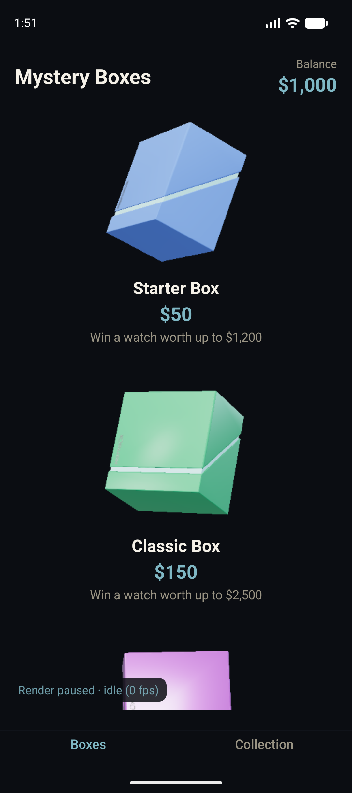
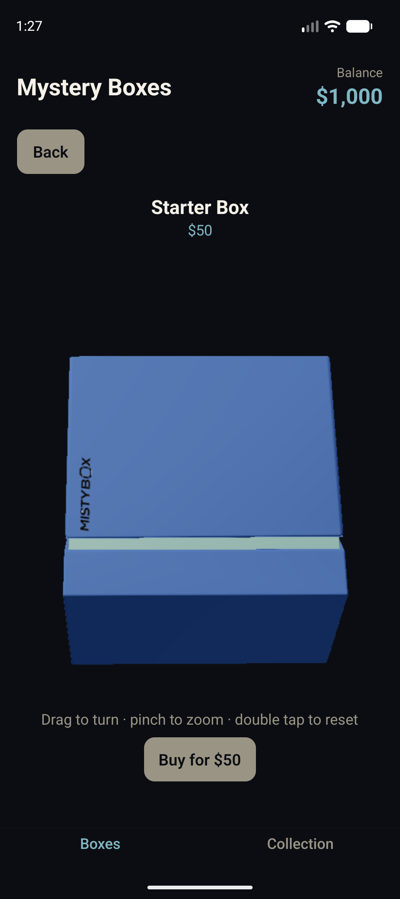
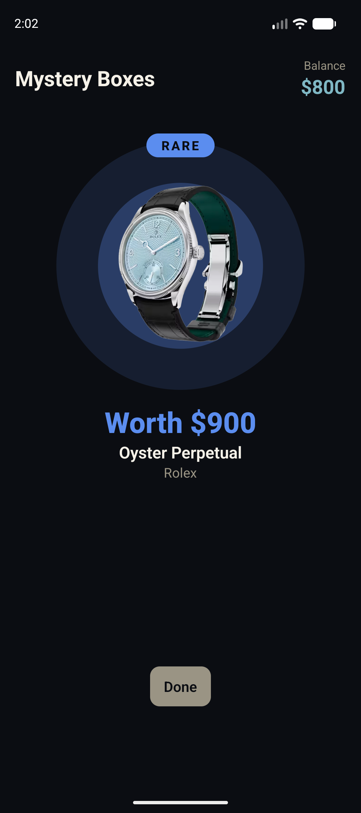
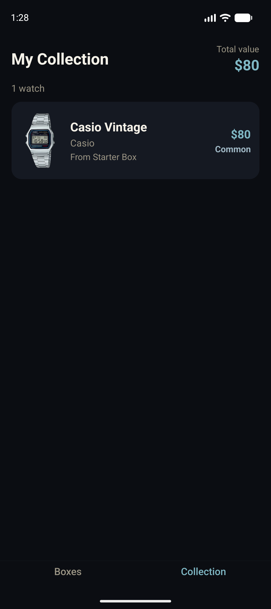
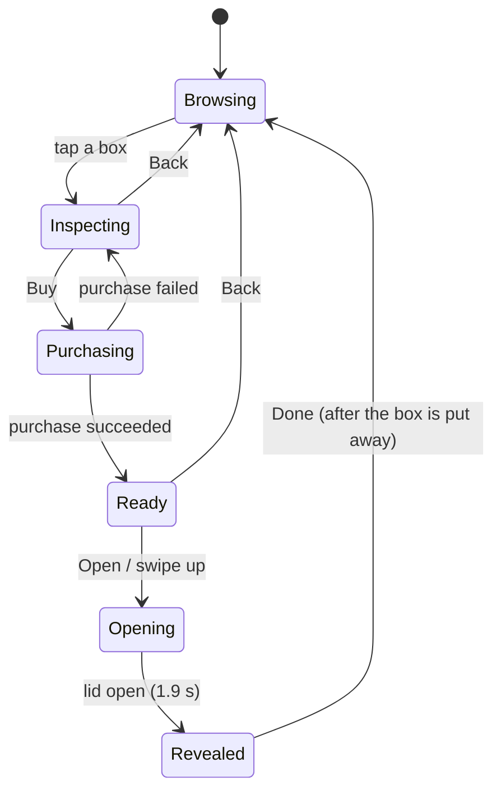
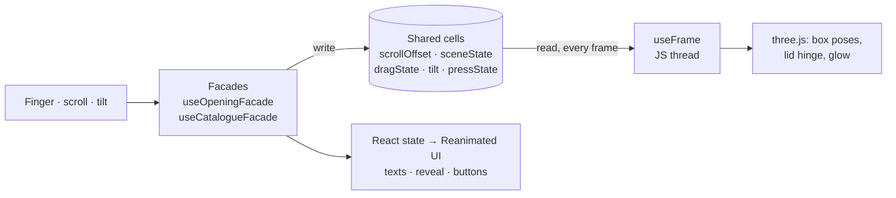
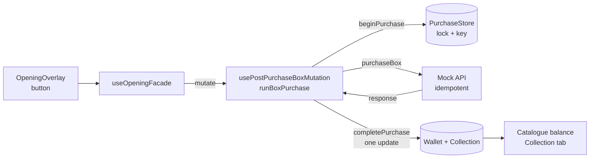

# `Mystery Watch R3F` - React Native Proof of Concept

[](https://expo.dev/)
[](https://reactnative.dev/)
[](https://www.typescriptlang.org/)
[](https://threejs.org/)
[](https://r3f.docs.pmnd.rs/)
[](https://docs.swmansion.com/react-native-reanimated/)
[](https://zustand-demo.pmnd.rs/)
[](https://tanstack.com/query/latest)

> **Documentation map:** [docs/README.md](docs/README.md) · **how to test:** [docs/TESTING.md](docs/TESTING.md) · **animations:** [docs/ANIMATIONS.md](docs/ANIMATIONS.md) · **the show:** [docs/EFFECTS.md](docs/EFFECTS.md) · **test results:** [docs/TEST_CHECKLIST.md](docs/TEST_CHECKLIST.md) · **FPS:** [docs/PERFORMANCE.md](docs/PERFORMANCE.md)
>
> **One rule above all:** test on **one platform at a time**. Either the Android emulator with the iOS simulator shut down, or the iOS simulator with the Android emulator shut down. They share the Mac's GPU and CPU; with both open you get false jank and useless FPS numbers ([why and how to switch](docs/TESTING.md#rule-1-one-platform-at-a-time)).

## Table of Contents

1. [Introduction](#1-introduction)
2. [Quick Start](#2-quick-start)
3. [The App](#3-the-app)
4. [Project Architecture](#4-project-architecture)
5. [Real-time 3D](#5-real-time-3d)
6. [three.js on WebGPU](#6-threejs-on-webgpu)
7. [Quality Gates and Tests](#7-quality-gates-and-tests)
8. [Performance](#8-performance)
9. [Project Structure](#9-project-structure)
10. [Known Limits and Decisions](#10-known-limits-and-decisions)
11. [Troubleshooting](#11-troubleshooting)

---

## 1. Introduction

**Project Overview:**
Mystery Watch R3F is a proof of concept for discovering, buying and opening mystery boxes that contain watches. A scrollable catalogue shows **real-time rendered 3D boxes**, you tap one to **inspect it with your finger and open it** with an animated lid and a reveal, a virtual balance pays for it, and the watches you win go into your collection. The assignment is in [docs/ASSIGNMENT.md](docs/ASSIGNMENT.md).

The 3D layer is **three.js through React Three Fiber, drawn with WebGPU** (`react-native-webgpu`: Metal on iOS, Vulkan on Android): one canvas behind the list and a render loop in JavaScript. It used to be expo-gl (OpenGL ES); [why it was dropped](docs/RENDERING_REPORT.md).

The code base follows the conventions of an enterprise React Native app: feature-based **flows**, logic-less UI, **facades** for business logic, **adapters** for data mapping, Zustand for client state and React Query for async (mock-API) state.

**Definition of done:**
- the full flow works: browse → inspect → buy → open → reveal → collection
- every successful purchase makes **exactly one balance deduction and one watch** (also under repeated taps and lost responses)
- a failed purchase **changes nothing** (balance and collection stay the same) and can be retried
- the 3D scene holds **60 FPS** while scrolling, turning and opening on the iOS Simulator and, apart from short 30 FPS stretches at the start and during the opening, on the Android Emulator (see [Performance](#8-performance))

**Key Features:**

- 🧊 Real-time 3D with **three.js** through **React Three Fiber** drawn with **WebGPU** (`react-native-webgpu`)
- 🎯 **One shared canvas** for the whole app — the same box instances are in the list and in the opening screen
- 🔩 Exact **hinge kinematics** for the lid and wordmark (pivot `[0, 0.914876, 0.359181]`, 0° → 115°)
- ✋ **Inspect with your fingers:** drag with inertia, pinch to zoom, double tap to reset, swipe up to open, device tilt; anticipation shake, animated lid with light from inside, rarity-based reveal (Common → Legendary), sounds and haptics
- 💸 Purchase with an **exactly-once guarantee** (idempotency keys, atomic state update, lock against repeated taps)
- 🏗️ Feature-based (flows) architecture, facades, adapters, typed navigation
- 🔄 Zustand (the balance and the bought watches are saved to a file; the rest is session-scoped) + React Query over an asynchronous mock API with a failure switch
- 🧪 Jest + React Native Testing Library, ESLint 9 + Prettier, `ciPipeline`
- 📦 **No native 3D code of our own and nothing vendored** — three.js, R3F and `react-native-webgpu` (with its prebuilt Dawn binaries) come from npm, so the project builds on a clean machine
- 🌟 A **show around the box**: breathing and flashing seams, a soft light curtain from the open box to the watch, shock waves, sparks, camera punch, lid settle, hold-to-open — bigger for rarer prizes ([docs/EFFECTS.md](docs/EFFECTS.md))
- 🎨 **One shared colour grade** (more saturation and contrast) applied to the boxes, identical in all three repositories, so the boxes look equally rich everywhere
- 🧭 A [rendering report](docs/RENDERING_REPORT.md): why expo-gl was dropped for WebGPU, and how this repository compares with the other two
- ✨ A full set of animations (push-in, anticipation, rarity reveal, gestures, sound) described with screenshots in [docs/ANIMATIONS.md](docs/ANIMATIONS.md)
- 📊 Reproducible performance tooling and an honest [performance report](docs/PERFORMANCE.md)

**Tech Stack:**

| Area | Choice |
|---|---|
| Framework | Expo SDK 58, React Native 0.88.1 (new architecture), React 19.3 |
| Language | TypeScript 6.0 (strict) |
| 3D | `three` 0.187 (WebGPU build) + `@react-three/fiber` 9 (`/native`, the React reconciler for the scene) + `react-native-webgpu` (draws with WebGPU through Dawn: Metal / Vulkan). `expo-gl` stays installed only because R3F's native entry imports it for its Blob and texture polyfills: nothing is drawn with it |
| Animation / gestures | Reanimated 4.7 + `react-native-worklets` 0.13, Gesture Handler 3, Haptics |
| State | Zustand 5 (client), TanStack Query 5 (mock API) |
| Navigation | React Navigation 7 (bottom tabs) |
| Lists | FlashList 2 |
| i18n | i18next 27 |
| Tests | Jest 30 + React Native Testing Library 14 |
| Quality | ESLint 9 (flat) + Prettier 3, `expo-doctor` |

App id `com.gorrr.mysterywatch.r3f`, scheme `mysterywatchr3f`.

---

## 2. Quick Start

### Prerequisites

- macOS with **Xcode 27** and an iOS Simulator (Xcode 27 requires Expo SDK 58+)
- **Android Studio**, JDK 17, an AVD with **≥ 4 cores, ≥ 4 GB RAM, `hw.gpu.mode=host`**
- Node 24+ (developed on Node 26), yarn classic 1.22 (`corepack enable`), CocoaPods, watchman
- `export LANG=en_US.UTF-8` (CocoaPods needs a UTF-8 locale)

### Installation and first run

```bash
git clone https://github.com/GoRRRuslan/boxConceptOfProof-2
cd boxConceptOfProof-2

# Install dependencies (three.js and R3F come from npm, nothing else to download)
yarn install

# Generate the native projects
yarn iosPrebuild
yarn androidPrebuild

# Build and install the development client, then start Metro
yarn iosRun            # iPhone simulator
yarn androidRun        # Android emulator / device
yarn start
```

> The app is a **development build** (`expo-dev-client`): `react-native-webgpu` is a native module and is not in Expo Go.

### Just try it (recommended for reviewers)

A release build carries its JavaScript inside the app, so it needs no Metro server and no dev client. After `yarn install` and the prebuild commands above:

```bash
# Android: start any emulator (Android Studio, or: $ANDROID_HOME/emulator/emulator -avd <name> -gpu host), then
yarn androidRunRelease

# iOS: with a simulator booted
yarn iosRunRelease
```

> **Only one device at a time.** Before you start the Android emulator shut the iOS simulator down (`xcrun simctl shutdown all`), and the other way round (`adb emu kill`). Both at once give choppy frames that have nothing to do with the app. More: [docs/TESTING.md](docs/TESTING.md).

What to expect: scroll the list, tap a box, drag / pinch / double-tap it, buy it, swipe up (or tap *Open the box*), watch the reveal, then look at *Collection*. Each successful purchase costs exactly once and adds exactly one watch.

About smoothness: the scene is drawn by the GPU (Metal on iOS), so the **iOS Simulator** runs it at 60 FPS too (see [Performance](#8-performance)). Run the **Android Emulator with the host GPU** (`emulator -avd <name> -gpu host`): its default mode is SwiftShader, a CPU renderer. Give a freshly booted emulator a minute to finish its post-boot work.

### Run the quality gates

```bash
yarn ciPipeline   # ESLint + TypeScript
yarn test         # Jest + React Native Testing Library
```

### Release builds (what the performance numbers use)

> Run **one platform at a time** (iOS simulator **or** Android emulator, the other shut down): they share the Mac's GPU and CPU. See [docs/TESTING.md](docs/TESTING.md#1-the-golden-rules).

```bash
yarn androidEmulatorStart                 # Android emulator, headless (needed for exact FPS)
yarn androidRunOpening                    # release build with the FPS overlay
yarn iosRunOpening                        # same on iOS
```

### Scripts

| Script | What it does |
|---|---|
| `yarn start` | Metro for the development client |
| `yarn iosPrebuild` / `yarn androidPrebuild` | Clean native project generation (`expo prebuild --clean`) |
| `yarn iosRun` / `yarn androidRun` | Build and install the development client |
| `yarn iosRunRelease` / `yarn androidRunRelease` | Release build, JavaScript inside the app |
| `yarn ciPipeline` | **ESLint + TypeScript** (the gate for every change) |
| `yarn test` | Jest + RNTL |
| `yarn doctor` | `expo-doctor` health check |
| `yarn adbR` | `adb reverse tcp:8081 tcp:8081` |
| `yarn cleanNative` / `cleanCache` / `cleanNode` / `watchman` | Reset helpers |
| `yarn iosRestart` / `yarn androidRestart` / `yarn androidRestartRelease` | Relaunch the installed app without rebuilding |

The performance scripts are listed in [Performance](#8-performance).

---

## 3. The App

Two tabs: **Boxes** and **Collection**.

| Browse | Inspect | Reveal | Collection |
|---|---|---|---|
|  |  |  |  |

1. **Browse (Boxes tab).** Eight boxes at different prices, each a live 3D model with its own colour and a finish that gets glossier with the price. The card shows the price and the best possible prize; a box the balance cannot pay for says "Not enough balance". The balance is in the header and counts to its new value when it changes.
2. **Inspect.** Tap a box: it flies to the middle of the screen with a small push towards the camera. Drag to turn it (it keeps turning after you let go), pinch to zoom, double tap to reset; left alone it turns slowly by itself and leans with the phone. **Back** is in the top left corner, the box name and price are centred below it.
3. **Buy.** One button. While the purchase runs the button is disabled and you cannot leave. On success the balance drops by the price and the watch is yours; on failure you see why ("Nothing was charged") and can try again.
4. **Open.** Press the button or swipe up. The box shakes and swells (anticipation), the lid swings open about its hinge and a light of the prize's colour shines from inside.
5. **Reveal.** A rarity pill (Common, Rare, Epic, Legendary!), the watch in two glowing circles, a flash and particles for the better prizes, then the price, name and brand. After a moment the opened box is put away; only then does **Done** appear. While a prize is shown the tab bar is invisible. **Done** returns to the list.
6. **Collection tab.** Your watches, newest first, with the total value; tap a row for a large picture; an empty state with a "Browse boxes" button when you have none. The balance and the bought watches are saved to a file, so they survive the system removing the app from memory in the background.

Detailed write-ups with screenshots: [animations](docs/ANIMATIONS.md) · [3D model](docs/MODEL.md) · [test checklist](docs/TEST_CHECKLIST.md).

### The phases of one box



Pure and unit-tested: [`openingPhaseMachine.ts`](src/flows/openingFlow/_facadesLogic/openingPhaseMachine.ts). An event that does not belong to the current phase is ignored, so a double tap or a late result can never push the flow into a wrong state.

### The purchase guarantee

Balance and collection change in **one place** — `PurchaseStore.completePurchase` — in a single state update, only when the API succeeded, the response belongs to the running purchase and its idempotency key was not applied before.

| Case | Result |
|---|---|
| Success | one deduction + one watch |
| Not enough balance | refused before the API; nothing changes |
| Network / server error | nothing changes; the next purchase is unlocked |
| Repeated taps while a purchase runs | extra taps ignored (synchronous lock), the API is called once |
| Response lost (server did process it) | the retry re-uses the idempotency key → same watch, still **one** deduction |

The mock API (`src/networking/api/MysteryBoxApi`) is asynchronous (700 ms), idempotent per key, and has a failure switch: `EXPO_PUBLIC_MOCK_PURCHASE_FAILURE=networkError | serverError | responseLost` (or `mockApiSettings` in code and tests). The prize is rolled deterministically from the purchase key, so a retry can never become a different watch.

---

## 4. Project Architecture

### Core Principles

1. **Feature-Based (flows) Architecture:** code is organised by business feature, not by technical layer
2. **Logic-less UI:** screens and components render; every piece of logic sits in a facade (`_facades`) or a pure function (`_facadesLogic`)
3. **Separation of Concerns:** UI → facade → adapters/stores/queries → services
4. **Typed everywhere:** strict TypeScript, facade return types live in `_types/`
5. **Testability:** business logic is in hooks and pure functions that are unit-tested without rendering
6. **The frame loop never waits for React:** React writes small shared values, `useFrame` reads them every frame

### Architecture Layers

```
┌─────────────────────────────────────────────┐
│ Presentation   screens · components · styles │  render only
├─────────────────────────────────────────────┤
│ Business logic facades (use…Facade)          │  state, handlers, effects
│                _facadesLogic (pure functions)│  maths, rules, easing
├─────────────────────────────────────────────┤
│ Data           adapters · Zustand · React    │  mapping, session state,
│                Query over the mock API       │  async (mock) API
├─────────────────────────────────────────────┤
│ Services       animation · sounds · haptics  │  one job each, no UI
│                boxModel · sceneSync        │
│                performance                   │
├─────────────────────────────────────────────┤
│ Rendering      three.js scene · R3F          │  per-frame 3D
│                (useFrame on the JS thread)   │
├─────────────────────────────────────────────┤
│ Navigation     tab navigator                 │
├─────────────────────────────────────────────┤
│ Platform       Expo / React Native / WebGPU │
└─────────────────────────────────────────────┘
```

### Inside a flow

```
flows/<name>Flow/
├── _adapters/      map API/store data to what a screen shows (pure, useMemo)
├── _config/        numbers and constants of the feature (timings, sizes, rarity styles)
├── _facades/       useXxxFacade: translations → navigation → state → store → queries → adapter → values → handlers → effects
├── _facadesLogic/  pure functions (no React, no three.js, so they are unit-tested directly)
├── _types/         facade return types and shared interfaces
└── screens/<Screen>/
    ├── <Screen>.tsx · .styles.ts · index.ts
    ├── _components/<Part>/   a part with its own _facades/ when it needs logic or animation
    └── __tests__/
```

### The three flows

| Flow | Owns | Key files |
|---|---|---|
| `catalogueFlow` | The list, the one shared 3D canvas, box poses, finishes, lights, entrance and press animations, the balance | `useCatalogueFacade`, `useFacadeCatalogueBoxes` (the per-frame callback), `computeBoxPose`, `sceneRenderConfig` |
| `openingFlow` | The phases, buying, gestures, anticipation, lid, glow, reveal, putting the box away, haptics, sounds | `useOpeningFacade`, `openingPhaseMachine`, `openingSceneState`, `computeOpeningPose`, `stepDragInertia`, `rarityConfig`, `OpeningOverlay` |
| `collectionFlow` | The collection tab, its rows, the detail sheet, the total value | `useCollectionFacade`, `useAdapterCollectionItems`, `CollectionDetailModal` |

### How React talks to the frame loop



- React only **writes** small values (scroll offset, which box is open and when each animation started, drag, tilt, press) into plain mutable cells (`services/sceneSync/createSharedValue.ts`). `useFrame` **reads** them before every frame and computes poses, lid angle and glow itself.
- Animations in the scene are **time-based** from a start timestamp (see `computeAnimatedProgress`), so React never has to tick.
- There is **no worklet runtime in the 3D path**: `useFrame` runs on the JavaScript thread, so the helpers it calls need no `'worklet'` directive (Reanimated is used for the UI overlay only).

### Data flow of a purchase



### Timers of an opening

`useOpeningFacade` keeps every timer of an opening in one list (`openingTimers`): the lid sound, the reveal, the box being put away, and the moment the renderer may rest. They are all cancelled by **Back/Done**, by selecting another box and on unmount, so a late timer can never act on the next box.

### Conventions (enforced by ESLint and `CLAUDE.md`)

- No abbreviations in names; English only in code
- No hard-coded visible strings — everything through `t()`
- No logic in UI files; no fallback substitution (guard → warn → return)
- Facade sections in strict order: translations → navigation → state → store → queries/mutations → adapters → values → handlers → effects
- `FlashList` for lists, `testID` on every interactive element, no inline styles or colour literals (colours live in `utils/designSystem/Theme.ts`)
- Path aliases: `@app`, `@flows`, `@components`, `@models`, `@networking`, `@services`, `@utils`, `@assets`, `@i18next`, `@configs`, `@navigation`

---

## 5. Real-time 3D

### One canvas for the whole app

There is one GL context and one R3F canvas (`CatalogueScene`) behind a list of transparent cards; the opening experience reuses the same box instances. UI overlays are React Native views.

```
┌──────────────── FlashList (transparent cards) ────────────────┐
│  name · price · prize         ← React Native views            │
├───────────────────────────────────────────────────────────────┤
│  ONE R3F canvas on WebGPU (behind the list)                   │
│   box #1   box #2   box #3 …   ← one GLB, one instance a card │
└───────────────────────────────────────────────────────────────┘
        ▲ every frame: pose of each box = f(scroll offset, opening state)
```

- `useFacadeCatalogueBoxes` loads `box.glb` once (`services/boxModel/loadBoxModel.ts`, preloaded at app start), makes one instance per card (`createBoxInstance`: shared geometry, own body and glow materials) and places and animates them in `useFrame`.
- On every scroll event the offset is written into a shared cell; right before each frame the loop reads it and places every box in its card's slot ([`computeBoxPose`](src/flows/catalogueFlow/_facadesLogic/computeBoxPose.ts)). React is not involved per frame.
- When a box is opened, React writes a tiny state (which box, start times, targets); the loop computes the fly-in, the camera push, the lid angle, the glow, the drag inertia and the putting-away by itself ([`computeOpeningPose`](src/flows/openingFlow/_facadesLogic/computeOpeningPose.ts), [`openingSceneState`](src/flows/openingFlow/_facadesLogic/openingSceneState.ts), [`stepDragInertia`](src/flows/openingFlow/_facadesLogic/stepDragInertia.ts)).
- **Where per-frame work runs:** on the JS thread inside `useFrame`. The cost is a few transforms for at most ~5 visible boxes, so JavaScript is not the bottleneck; the GPU is ([Performance](docs/PERFORMANCE.md)).
- **Render on demand:** `frameloop` is `always` while something moves and goes back to `demand` after a run of quick frames ([`RenderOnDemand`](src/components/RenderOnDemand)), so the GPU rests on a still screen.
- **Look:** lights, shadows only while a box is inspected or opened, a finish that gets glossier with the box price ([`sceneRenderConfig.ts`](src/flows/catalogueFlow/_config/sceneRenderConfig.ts)); settings per platform are explained in [Performance](docs/PERFORMANCE.md).

### What the scene reads every frame

| Shared value | Written by | Meaning |
|---|---|---|
| `scrollOffset` | list scroll | where each box sits |
| `sceneState` | opening facade | which box is open; start times of focus, lid, anticipation, putting away; glow colour |
| `dragState` | gestures + the frame loop | turn, zoom, inertia, auto-turn, reset |
| `tilt` | device motion | how far the phone leans |
| `pressState` | card press | which box is squeezed |
| `entranceStartedAt` | scene (on the first frame with boxes, `resolveEntranceStart`) | when the boxes pop in |

### Hinge kinematics

The lid (`Shell_Lid`) and the wordmark (`Shell_Wordmark`) have identity node transforms, so their origins are not hinge pivots. The rotation about the documented pivot `p` is `T(p) · R(θ) · T(−p)`, set as an absolute transform every frame. Pure helpers with unit tests live in `services/lidHinge`. The model itself is described in [docs/MODEL.md](docs/MODEL.md).

---

## 6. three.js on WebGPU

React Native has no WebGL, no DOM and no Web Workers. Everything that makes three.js run here is a small, documented decision:

- **`react-native-webgpu`** (Dawn: **Metal on iOS, Vulkan on Android**) gives a WebGPU context; [`WebGpuCanvas`](src/components/WebGpuCanvas/WebGpuCanvas.tsx) creates a `WebGPURenderer` on it and hands it to React Three Fiber (`createRoot` from `@react-three/fiber/native`, which also supplies the Blob and texture polyfills). `context.present()` runs after every frame. The packages come from npm: **no vendored source, no native 3D code of our own**.
- **Metro resolves `three` to its WebGPU build** (`three.webgpu.js`, which contains the whole core), see [`metro.config.js`](metro.config.js). Standard three.js materials (`MeshStandardMaterial`, `MeshPhysicalMaterial`, `MeshBasicMaterial`) are converted to node materials by the renderer; nothing in the scene code is WebGPU-specific.
- **The model is an uncompressed GLB.** Draco and KTX2 decoders need Web Workers and WASM, which React Native lacks. [`scripts/assets/optimizeBoxModel.sh`](scripts/assets/optimizeBoxModel.sh) rebuilds the file from `assets-source/`; the watch images are WebP ([`optimizeWatchImages.sh`](scripts/assets/optimizeWatchImages.sh)).
- **Full quality everywhere:** native resolution, 4x MSAA, 2048 shadow map with shadows always on (switching them recompiles every material, a stall of about a second), a reflection environment (PMREM), tone mapping and the clear coat. With expo-gl none of these fitted: see [docs/RENDERING_REPORT.md](docs/RENDERING_REPORT.md).
- **Sounds are prepared at idle** (`soundEffects.prepare`): creating the audio session and the first player on the first sound blocks JavaScript for about a second.
- **Android emulator:** use the host GPU (`-gpu host`). The default mode is SwiftShader (software Vulkan), which gives about 10 to 30 FPS.

---

## 7. Quality Gates and Tests

> **Everything about testing is in [docs/TESTING.md](docs/TESTING.md)**: the golden rules, which build to install, manual testing on iOS and on Android, FPS testing, and where results are recorded. Results and bugs found: [docs/TEST_CHECKLIST.md](docs/TEST_CHECKLIST.md).

```bash
yarn ciPipeline   # eslint . && tsc --noEmit      → must be clean
yarn test         # jest                            → 271 tests
yarn doctor       # expo-doctor
```

| Check | Status |
|---|---|
| ESLint (strict-type-checked, stylistic, react-native, react-hooks) | ✅ clean |
| TypeScript 6 strict | ✅ clean |
| Jest + RNTL | ✅ 271 / 271 |
| Full flow on Android 37, including the animations | ✅ (see [checklist](docs/TEST_CHECKLIST.md)) |
| Full flow on the iOS Simulator | ✅ 60 FPS (see [Performance](#8-performance)) |

**What the tests cover**

| Area | Tests |
|---|---|
| Purchase rules | store (lock, exactly-once, failure, retry key), mock API (idempotency, latency, failure modes, prize roll), `runBoxPurchase` end to end, the mutation hook |
| Opening | phase machine, easing and progress, scene state (focus, lid, anticipation, glow, putting away), pose maths, drag inertia, rarity, particle paths, the opening facade end to end |
| Catalogue / collection | pose maths, camera field of view, entrance and press maths, finishes, card and row adapters, both facades, collection value |
| 3D plumbing | `createSharedValue`, `createBoxInstance`, `resolveEntranceStart`, `RenderOnDemand` |
| UI | `BoxCard`, `OpeningOverlay`, `CatalogueScreen`, `CollectionScreen`, `ScreenHeader`, `AnimatedCurrencyText`, `AppButton` |
| Services | animated numbers, sounds (player pool), device tilt, FPS summary |

Not unit-tested (verified on devices instead): the real look of the animations, real audio and haptics, device tilt, anything that needs a real GL context.

---

## 8. Performance

**Result (release builds, simulator and emulator on an Apple Silicon Mac): the iOS Simulator runs the whole flow at 60 FPS (36 one-second windows, average 59.8; one window of 52 FPS at app start, while the first frames compile pipelines). The Android Emulator with the host GPU holds 60 FPS in the catalogue and in inspect, with stretches of 30 FPS during the entrance and parts of the opening (JavaScript-bound, see below).** Compared with the other two repositories and the reasons: [docs/RENDERING_REPORT.md](docs/RENDERING_REPORT.md). Full numbers: [docs/PERFORMANCE.md](docs/PERFORMANCE.md). How to run the measurements: [docs/TESTING.md](docs/TESTING.md).

- Frame rate comes from an **in-app FPS meter** that counts R3F frames (`useFrame`), one-second windows, plus the sink log in `docs/data`.
- No physical device has been measured.
- **Run one platform at a time** (they share the Mac's GPU and CPU, so running both gives false jank). Use release builds. Start the Android emulator with `-gpu host`.

| Command | Purpose |
|---|---|
| `yarn androidEmulatorStart` / `yarn androidEmulatorStop` | Boot / stop the Android emulator **headless** |
| `yarn androidRunCatalogueScroll` / `yarn iosRunCatalogueScroll` | Build a release app whose catalogue scrolls by itself |
| `yarn perfAndroidCatalogue` / `yarn perfIosCatalogue` | Measure FPS while the catalogue scrolls |
| `yarn androidRunOpening` + `yarn perfAndroidOpening` | Play the whole opening flow on the emulator, screenshots + FPS |
| `yarn iosRunOpening` | Build a release iOS app with the FPS overlay |
| `yarn perfSinkStart` / `yarn perfSinkStop` | Collector that receives the iOS meter's reports |
| `yarn perfAndroidPresentFps` | Independent FPS from SurfaceFlinger presented frames |
| `yarn perfIosFps` / `yarn perfAndroidFps` | Quick FPS sample of the running app |
| `yarn assetsSounds` | Re-synthesise the sound effects in `src/assets/sounds` (see [docs/ANIMATIONS.md](docs/ANIMATIONS.md)) |
| `yarn assetsOptimize` | Re-encode the GLB and the watch images (WebP) from `assets-source/` |

Environment variables (build time): `EXPO_PUBLIC_SHOW_PERFORMANCE=1` (FPS overlay), `EXPO_PUBLIC_AUTO_SCROLL=1`, `EXPO_PUBLIC_PERF_SINK_URL`, `EXPO_PUBLIC_MOCK_PURCHASE_FAILURE`. If a release build seems to use old JavaScript, see [Troubleshooting](#11-troubleshooting).

---

## 9. Project Structure

```
boxConceptOfProof-2/
├── CLAUDE.md                         # project rules (adapted from the reference app)
├── app.config.ts                     # Expo config (dynamic; plugins incl. expo-audio)
├── babel.config.js · metro.config.js # aliases, worklets plugin, .glb assets, three ES build
├── eslint.config.mjs · .prettierrc.json
├── docs/                             # see docs/README.md for the map
│   ├── README.md · TESTING.md · TEST_CHECKLIST.md · PERFORMANCE.md · ANIMATIONS.md
│   ├── ASSIGNMENT · MODEL
│   └── media/                        # screenshots
├── assets-source/                    # source GLB and watch images
├── scripts/
│   ├── app/                          # restart, headless emulator, tap by testID
│   ├── assets/                       # GLB and WebP optimisation, sound synthesis
│   └── perf/                         # FPS meter collector, catalogue scroll, opening flow, analysis
├── __tests__/                        # app-level tests
└── src/
    ├── app/                          # App.tsx, useAppFacade.ts, App.styles.ts
    ├── assets/                       # models/box.glb · images/watches/{full,thumb}/*.webp · sounds/*.wav
    ├── components/                   # shared UI: ScreenHeader · AnimatedCurrencyText · FadingView · RenderOnDemand · FrameMeter · WebGpuCanvas · PerformanceOverlay · AppText · buttons/AppButton · _layout/ScreenContainer
    ├── navigation/                   # tab navigator (hides its bar while a prize is shown), navigation container + theme, route types
    ├── models/mainStorage/           # WalletStore · CollectionStore · PurchaseStore · _storeConfigured (Zustand; balance and collection saved to a file)
    ├── networking/                   # api/MysteryBoxApi (mock, prize roll) · requests/{queries,mutations} · errorHandling
    ├── flows/
    │   ├── catalogueFlow/            # _adapters · _config (layout, scene render) · _facades · _facadesLogic (poses, finishes, entrance) · screens/CatalogueScreen (BoxCard, CatalogueScene, CatalogueBoxes, SceneLighting)
    │   ├── openingFlow/              # _config (timings, rarity) · _facades (opening, device tilt) · _facadesLogic (phases, scene state, pose, inertia, rarity) · screens/OpeningOverlay (RevealEffects, WatchRevealImage, Particle)
    │   └── collectionFlow/           # _adapters · _facades · _facadesLogic · screens/CollectionScreen (WatchListItem, CollectionDetailModal, EmptyCollection)
    ├── i18next/                      # i18init.ts · translations/en.json
    ├── services/                     # animation · boxModel (GLB loader, instances) · sceneEffects · sceneSync (shared cells) · lidHinge · sounds · haptics · performance (FPS meter, startup timeline) · reactQuery
    └── utils/                        # designSystem/Theme · formatCurrency · delay · watchImageSources · testing/reanimatedStub
```

---

## 10. Known Limits and Decisions

- **Simulators/emulators only.** Neither a physical iPhone nor a physical Android phone has been measured. On Android the frame loop is JavaScript-bound during the entrance and the opening (30 FPS stretches on the emulator); the other two repositories do that work natively.
- **All numbers come from the iOS Simulator and the Android Emulator (host GPU)** on an Apple Silicon Mac; that GPU is much faster than a phone's.
- **One platform at a time** when testing or measuring (shared Mac GPU and CPU); see [docs/TESTING.md](docs/TESTING.md#rule-1-one-platform-at-a-time).
- **Frame loop on the JS thread.** `useFrame` runs in JavaScript, not on a UI or render thread. It is fast enough for a handful of boxes, but heavy JavaScript work during an animation would show up as dropped frames.
- **No Draco / KTX2.** Their decoders need Web Workers, so the GLB is uncompressed.
- **Session-only state:** the balance ($1,000), the collection and the purchase log live in memory; a restart begins a new session.
- **Prize roll is deterministic per purchase key** in the mock (so a retry can never turn into a different watch); the odds come from each box's drop table.
- **Camera and light are fixed;** the opening "push-in" is done by moving and scaling the box.
- Leaving after buying without opening is allowed — the watch is already in the collection.
- **Rendering stops on its own:** after a reveal the renderer rests once the opened box has been put away; any change of phase wakes it.
- **Not covered by tests or checks:** real audio and haptics (only the calls are tested), device tilt (not testable in a simulator), and any physical device (none was measured).

---

## 11. Troubleshooting

| Symptom | Cause / fix |
|---|---|
| `pod install` fails with *Unicode Normalization not appropriate for ASCII-8BIT* | `export LANG=en_US.UTF-8` |
| iOS app crashes at launch on iOS 27 | Xcode 27 requires the UIScene lifecycle; use **Expo SDK 58+** (this project) |
| `expo run:ios` ends with an osascript error about the *Simulator* window | Xcode 27 ships **DeviceHub.app** instead of Simulator.app. The app is already installed: run `yarn start` and open it (`xcrun simctl launch booted com.gorrr.mysterywatch.r3f`) |
| Blank screen on Android after adding navigation | The root container must be `flex: 1` without `alignItems: center` (see `App.styles.ts`) |
| Android emulator: 10 to 30 FPS, jagged edges | The emulator is in SwiftShader (software) mode: start it with `emulator -avd <name> -gpu host` |
| Metro fails with `process.emitWarning` / `three` import errors | `metro.config.js` must resolve `three` to the WebGPU build (`three.webgpu.js`); do not remove that resolver |
| Choppy frames, FPS well below 60 on Android | First check that **only one** simulator/emulator is running (`adb devices`, `xcrun simctl list devices booted`) and that you installed a **release** build; see [docs/TESTING.md](docs/TESTING.md#1-the-golden-rules) |
| Android emulator feels slow | Let a freshly booted emulator settle for a minute, use an AVD with ≥ 4 cores / ≥ 4 GB / `hw.gpu.mode=host`, and install a **release** build (`yarn androidRunRelease`), not the development client |
| Android emulator window does not open from a script or sandboxed shell | The windowed emulator needs a GUI session; start it from Android Studio or a normal terminal, or use the headless start (`yarn androidEmulatorStart`) |
| The list scrolls up and down by itself / an FPS overlay is on screen | You installed a **benchmark build** (`*RunCatalogueScroll`, `*RunOpening`). Install a normal one: `yarn iosRunRelease` / `yarn androidRunRelease` (or the development client: `yarn iosRun` / `yarn androidRun` + `yarn start`) |
| Release build shows old JavaScript (for example no FPS overlay in a benchmark build, or a fix that is not there) | Gradle does not track environment variables or always notice changes: delete `android/app/build/generated/assets/createBundleReleaseJsAndAssets` and `android/app/build/intermediates/assets/release`, then build again |
| Metro cache issues | `yarn cleanCache` |
