# Animations

Every animation in Mystery Watch: what it looks like, where it lives in the code and how it works. Screenshots are real, taken from release builds (Android on the MW_Pixel9_API_37 emulator, iOS on the iPhone 17 Simulator).

> The numbers in the code are the single source of truth. This page quotes them: if a value changes, change it in the file named under "Where".

- [1. The big picture](#1-the-big-picture)
- [2. Catalogue](#2-catalogue)
- [3. Inspecting a box](#3-inspecting-a-box)
- [4. Buying and opening](#4-buying-and-opening)
- [5. The reveal, by rarity](#5-the-reveal-by-rarity)
- [6. Collection](#6-collection)
- [7. Light, shadow and shine](#7-light-shadow-and-shine)
- [8. Sound and haptics](#8-sound-and-haptics)
- [9. Why it stays smooth](#9-why-it-stays-smooth)
- [10. Limits](#10-limits)

---

## 1. The big picture

Two kinds of animation run in two places:

| Kind | Runs in | Used for | Technology |
|---|---|---|---|
| **3D scene** | The R3F frame loop (`useFrame`, JavaScript thread, once per rendered frame) | Boxes, lids, light, camera push-in, drag, auto-turn | three.js through `@react-three/fiber/native` on `expo-gl` |
| **2D interface** | The Reanimated UI runtime | Texts, buttons, the reveal (pill, glow, watch image, particles), lists, tabs | `react-native-reanimated` |

One `<Canvas>` (`CatalogueScene`) sits behind a FlashList of transparent cards and draws every box. React writes the scene state (scroll offset, fingers, tilt, phase) into plain mutable cells (`services/sceneSync/createSharedValue.ts`); the frame loop reads them and moves the boxes. The pure maths (`computeBoxPose`, `computeOpeningPose`, `openingSceneState`, `stepDragInertia`, easing, lid hinge) has no React or three.js in it and is unit tested.

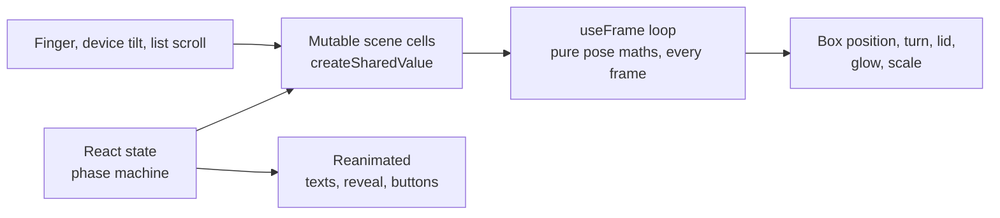

One whole purchase, as a timeline:

```mermaid
gantt
  dateFormat X
  axisFormat %Ls
  section Inspect
  Box flies to the middle (500 ms) :a1, 0, 500
  Slow auto-turn starts after 1.5 s idle :a2, 1500, 2500
  section Open
  Anticipation shake and swell (800 ms) :b1, 3000, 800
  Lid swings open (1100 ms) :b2, 3800, 1100
  section Reveal
  Pill, glow, watch flip, price :c1, 4900, 900
  Box waits, then is put away (700 ms) :c2, 6700, 700
```

---

## 2. Catalogue

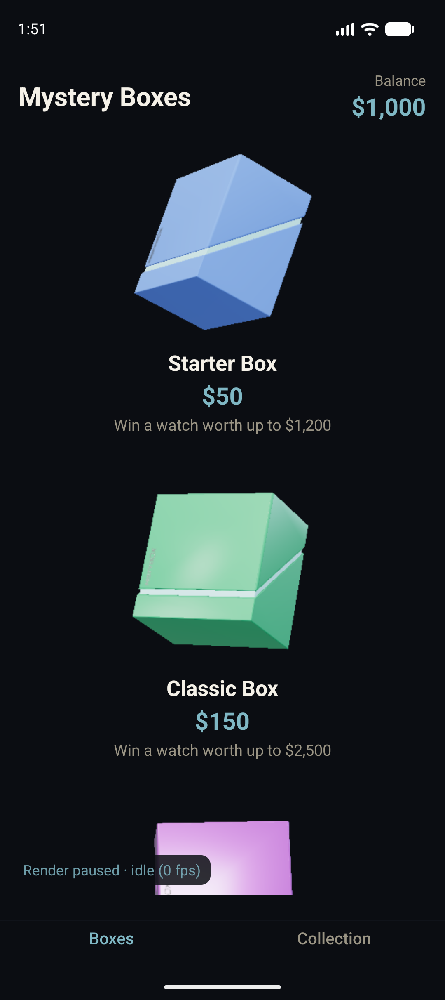

### Boxes pop in one after another

On the first appearance the boxes grow from nothing with a small overshoot, 90 ms apart, while their card texts fade in from below with the same rhythm.

- **Where:** the box: `getCardEntranceDelay.ts`, `resolveEntranceStart.ts`, `services/animation/useEntranceAnimation.ts`; the texts: `BoxCard.tsx` (`FadeInDown`); values in `catalogueLayoutConfig.ts` (`ENTRANCE_DURATION_MILLISECONDS` 520, `ENTRANCE_STAGGER_MILLISECONDS` 90, at most 5 staggered cards).
- **How:** the entrance starts at the first frame that has boxes, not at app start, so the pop-in is always visible even when the first frame is slow (shader compilation).

### Boxes follow the scroll

While the list scrolls, every box sits exactly in its card's transparent slot and turns a little (parallax). Neighbours have slightly different signature angles that repeat every three cards.

- **Where:** `computeBoxPose.ts`, applied in `useFacadeCatalogueBoxes.ts`.
- **How:** pure maths from the scroll offset. Boxes far outside the screen are hidden.

### Press squeeze

Pressing a card squeezes its box to 92 % in 140 ms and lets it spring back on release. If the finger slides away, the box bounces back without opening.

- **Where:** `computeCardAnimation.ts`, `useCatalogueFacade.ts` (press in / press out).

### Animated balance

Numbers count to their new value instead of jumping (balance in the header, total value in the collection).

- **Where:** `services/animation/useAnimatedNumber.ts` and `computeAnimatedNumber.ts`.

### Tabs fade

Switching between Boxes and Collection cross-fades. The inactive screen stays mounted, so the canvas and its GL context are never torn down.

- **Where:** `navigation/navigators/TabNavigator/TabNavigator.tsx`.

---

## 3. Inspecting a box

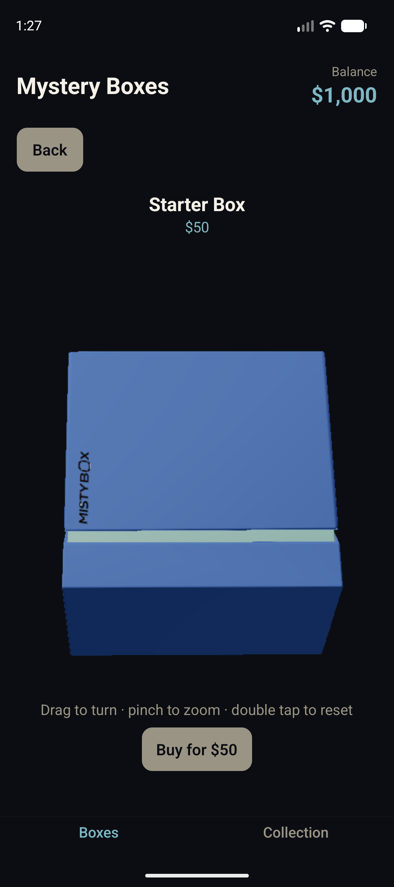

### Camera push-in (dolly)

Tapping a card sends its box to the middle in 500 ms. It also moves towards the camera with a small overshoot (0.9 units), so perspective makes it swell like a push-in. All other boxes shrink away. While a box is inspected the **Back** button sits in the top left corner and the box name and price are centred below it.

- **Where:** `computeOpeningPose.ts`, `openingSceneState.ts`, `openingEasing.ts`; values in `openingConfig.ts`.

### Gestures on the focused box

| Gesture | What happens | Values |
|---|---|---|
| Drag | The box turns under the finger; after a flick it keeps turning and slows down (inertia) | 0.012 rad per pixel, velocity x 0.94 every frame |
| Pinch | Zoom | 0.7x to 2x |
| Double tap | Turn and zoom glide back to the start | 0.05 % of the distance left after 1 s |
| Idle for 1.5 s | The box turns slowly by itself, easing in over 1 s | 0.4 rad per second |
| Device tilt | The box leans a little with the phone | up to 0.22 rad sideways, 0.14 rad up and down |
| Swipe up (after buying) | Opens the box, same as the button | 90 px |

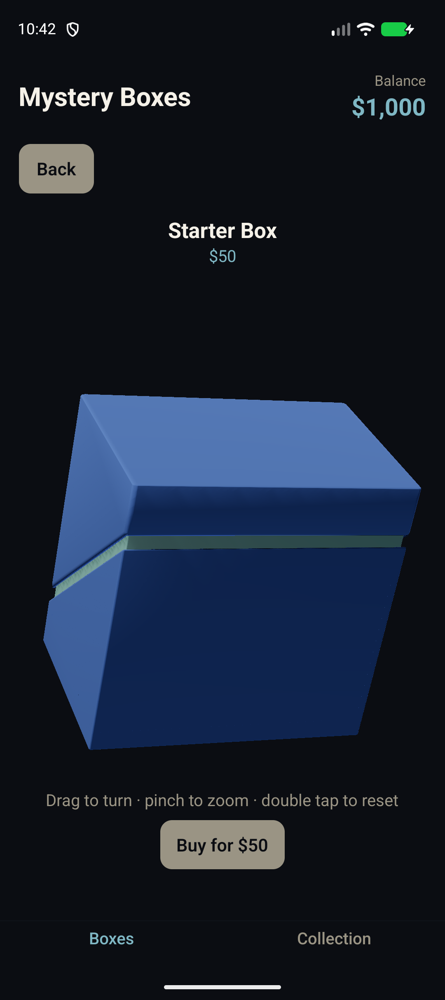

- **Where:** `useOpeningFacade.ts` (gestures with `react-native-gesture-handler`), `stepDragInertia.ts` (inertia), `useFacadeDeviceTilt.ts` (`expo-sensors`).
- **How:** the gestures write into the scene cells; inertia, auto-turn and the glide back run in the frame loop. While anything still moves the loop runs; when everything has stopped, it sleeps (section 9).

---

## 4. Buying and opening

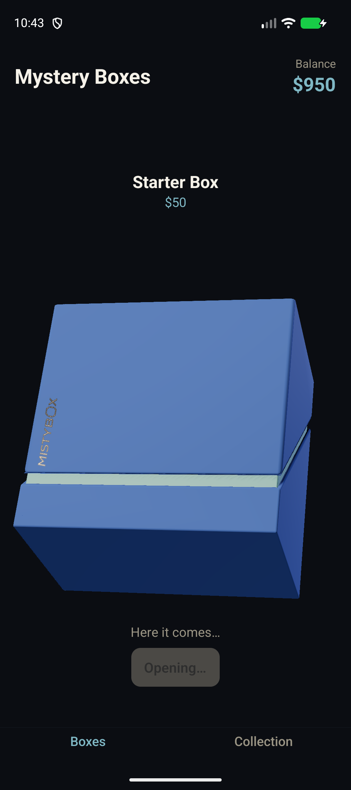 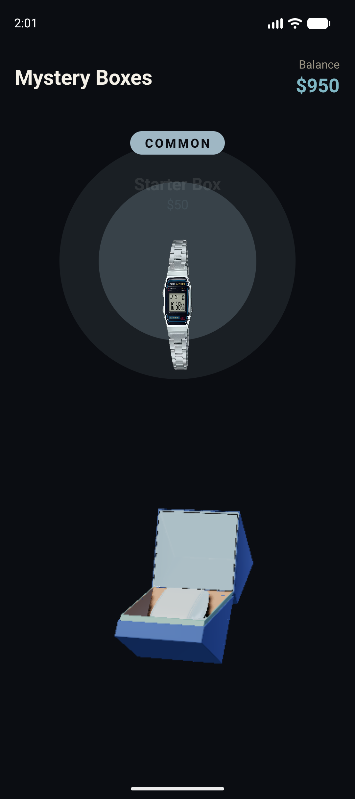

1. **Anticipation.** The box eases back to its base pose, then shakes harder and harder and swells by 10 % for 800 ms. A rumbling sound and a haptic buzz go with it.
2. **Lid.** It swings open about its real hinge with a small overshoot (`easeOutBack`), 1100 ms.
3. **Inner light.** While the lid opens, the cushion and the inside of the lid glow in the colour of the prize and then pulse softly (1.6 s period).

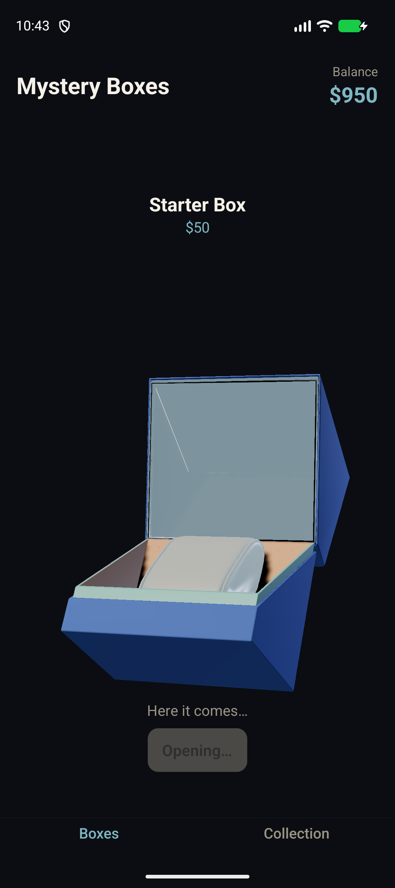

- **Where:** `openingSceneState.ts` (anticipation, glow strength), `services/lidHinge/computeLidHingeTransform.ts`, `createBoxInstance.ts` (glow materials), `openingConfig.ts`.
- **How:** the lid is a separate part of the model. Each frame it is rotated about the hinge pivot (0 to 115 degrees) and moved so it stays on the hinge. The glow is the emissive colour of the cushion and lid-inside materials. There is no bloom, so the light does not bleed into the picture.

A swipe up opens the box the same way. Whatever angle the box was turned to, it glides back to the base pose first, so an opened box always reads the same.

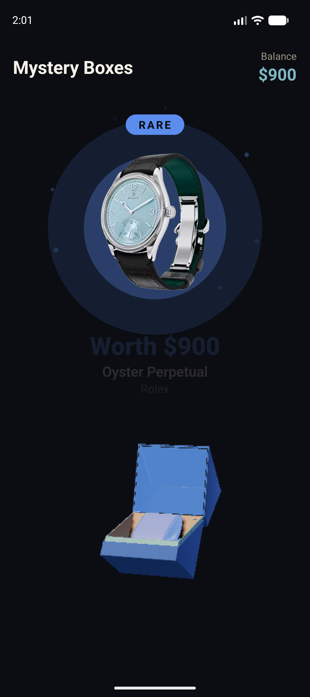

---

## 5. The reveal, by rarity

The prize is revealed on a clean stage. From the top: a **rarity pill**, the **watch** in two big pulsing circles, the **price** as the hero, then name and brand. The better the watch, the bigger the show:

| | Common | Rare | Epic | Legendary |
|---|---|---|---|---|
| Worth | under $500 | under $1,000 | under $2,000 | $2,000 and more |
| Colour | grey-blue | blue | purple | gold |
| Particles | none | 10 | 18 | 28 |
| White flash | none | none | 55 % | 90 % |
| Extra haptic taps | 0 | 1 | 2 | 3 |
| Sound | short chime | rising triad | rising triad (same as Rare) | full fanfare |

| Common | Rare | Epic | Legendary |
|---|---|---|---|
| 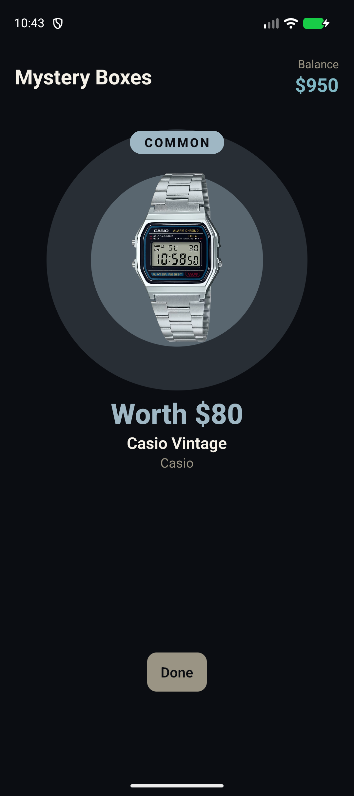 | 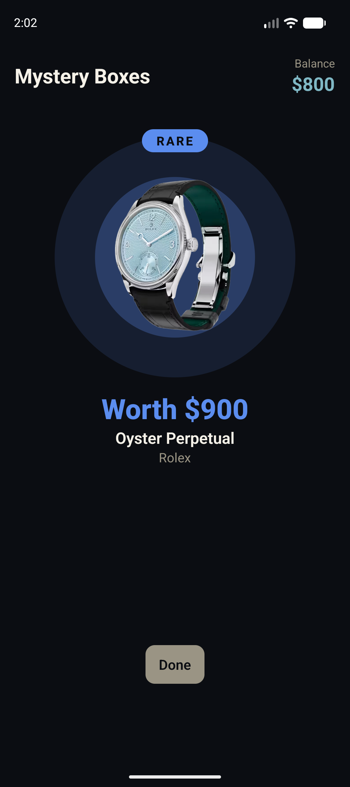 | 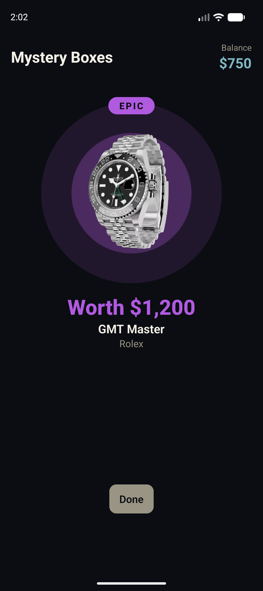 | 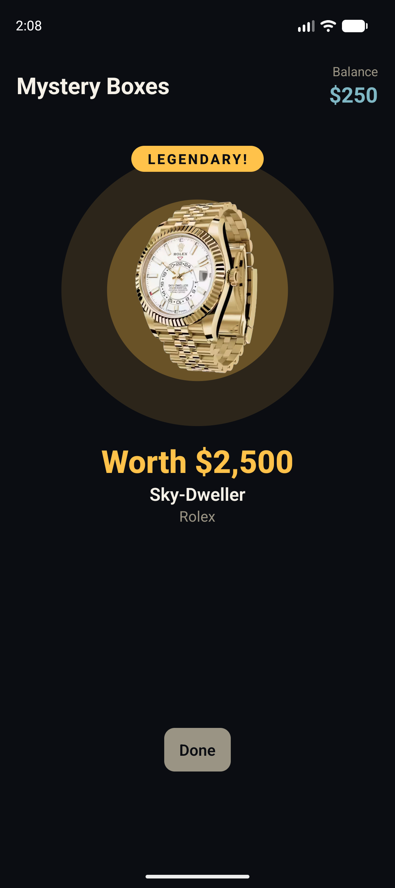 |

What happens, in order:

1. The **flash** and the **particles** burst out (under the watch, never over it).
2. The **watch** rises out of the box and flips like a coin (a flat `scaleX` flip with a spring, so it settles with a small bounce).
3. The two **circles** behind the watch pulse softly and without end.
4. The **price, name and brand** fade in from below after 450 ms.
5. After 1.8 s the **opened box is put away**: it shrinks to nothing and sinks a little in 700 ms. Only then does **Done** appear, centred at the bottom, so the prize is alone on the screen. While a prize is shown the bottom tab bar is invisible and cannot be tapped; its place is kept so the canvas does not move. Done brings the tab bar back and flies the box home.

- **Where:** `openingFlow/screens/OpeningOverlay/` (`OpeningOverlay.tsx` and the `RevealEffects`, `WatchRevealImage`, `Particle` parts, each with its hook in `_facades/`), `rarityConfig.ts`, `getWatchRarity.ts`, `computeParticleTrajectory.ts`, `computeOpeningPose.ts` (`tuckProgress`), `openingSceneState.ts` (`startTuck`). The tab bar is hidden through the `isTabBarHidden` route parameter set by `useCatalogueFacade` and read in `TabNavigator.tsx`.
- **Two design decisions:** the watch flips **flat**, not in 3D (a 3D-turned layer slid behind the glow circles and half of the watch looked washed out); and the flash and particles are drawn **under** the watch and its texts, so nothing covers the watch.

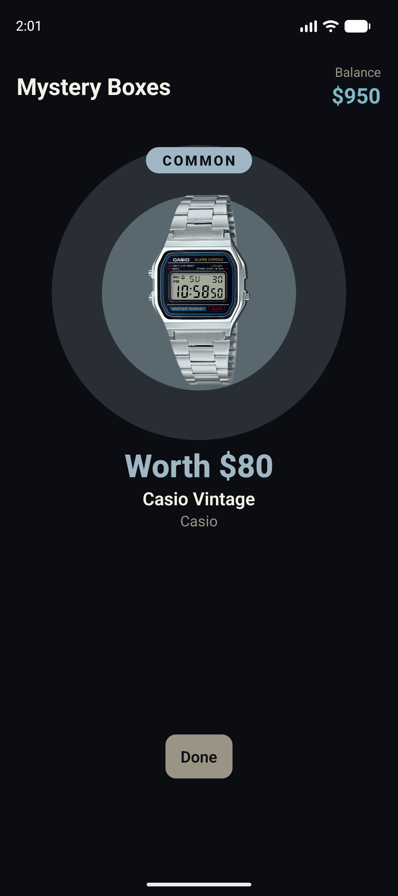

---

## 6. Collection

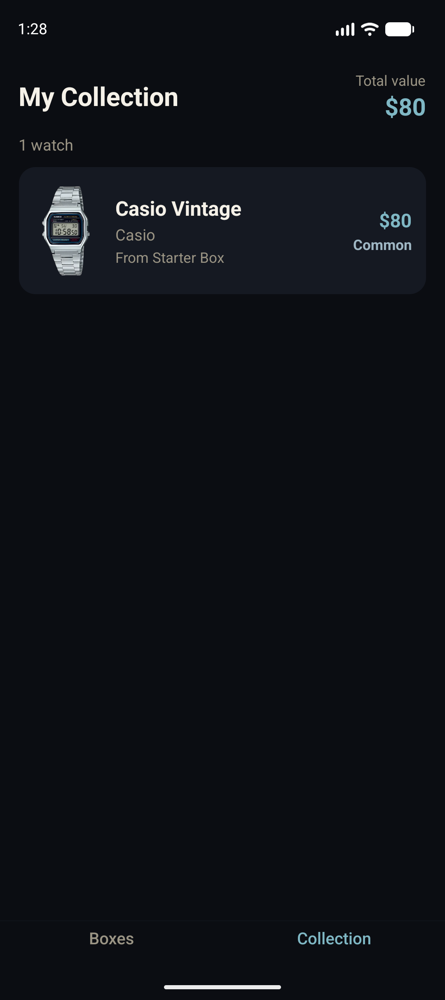

- Rows slide up one after another (`FadeInDown`, 400 ms). Each row shows the rarity in its colour.
- Tapping a row opens a detail sheet with the large photo and a border in the rarity colour.
- The total value counts up whenever a watch is added.
- If the balance is too low, the Buy button is disabled with a message ([screenshot](media/android-7-not-enough-balance.png)).
- **Where:** `collectionFlow/screens/CollectionScreen/` (`WatchListItem`, `CollectionDetailModal`), `useCollectionFacade.ts`.

---

## 7. Light, shadow and shine

- **Three lights.** A warm key light from the upper left (casts shadows), a cool rim light from behind that outlines the box against the dark background, and a soft fill from below (`SCENE_LIGHTS` in `sceneRenderConfig.ts`, drawn by `SceneLighting`). Intensities were tuned by eye. ACES filmic tone mapping.
- **Shadows.** The lid shades the inside of the box and the box shades its own lower edge: one shadow-casting light, 512 shadow map. Shadows are rendered **only while a box is inspected or opened**; the list draws none (a second depth pass costs frames).
- **Reflections.** A PMREM `RoomEnvironment` gives the glossy and metallic boxes something to reflect (`IS_ENVIRONMENT_ENABLED`, intensity 0.12).
- **Not implemented:** ambient occlusion and bloom.
- **Resolution.** Native resolution with 4x MSAA on both platforms (`RENDER_RESOLUTION_SCALE`, `IS_ANTIALIASING_ENABLED` in `sceneRenderConfig.ts`); the scene is drawn with WebGPU, see [PERFORMANCE.md](PERFORMANCE.md).
- **Finish by price.** The dearer the box, the more it shines (computed by `getBoxFinish`, applied as per-box `MeshPhysicalMaterial` values):

| Box price | Finish | Roughness | Metallic | Clear coat |
|---|---|---|---|---|
| under $100 | matte | 0.85 | 0 | 0 |
| under $300 | satin | 0.55 | 0.1 | 0.2 |
| under $700 | glossy | 0.30 | 0.3 | 0.7 |
| $700 and more | metal | 0.18 | 0.65 | 1 |

- **Where:** `getBoxFinish.ts`, `createBoxInstance.ts` (shared geometry, own body and glow materials per box), `SceneLighting`, `sceneRenderConfig.ts`.

---

## 8. Sound and haptics

Every sound is synthesised by a script (`yarn assetsSounds`, `scripts/assets/generateSounds.py`): no downloads, no licences, each file well under 100 KB.

| Moment | Sound | Haptic |
|---|---|---|
| Box selected | soft tick | selection tick |
| Purchase | two rising blips | success |
| Anticipation | rising rumble | light impact |
| Lid opens | click and falling thump | heavy impact |
| Reveal | chime, triad or fanfare by rarity | success, then 0 to 3 heavy impacts 140 ms apart |
| Error | falling buzz | error |

- **Where:** `services/sounds/soundEffects.ts` (`expo-audio`), `services/haptics/hapticFeedback.ts` (`expo-haptics`).
- Sounds play even with the silent switch on and mix with other audio. Each effect has two players used in turn, so opening boxes quickly never cuts a sound off.

---

## 9. Why it stays smooth

- **Render on demand.** `frameloop` is switched to `always` while something moves and back to `demand` after a run of quick frames, so the GPU rests on a still screen (`components/RenderOnDemand`).
- **One canvas, one GL context.** All boxes live in one scene; each costs one transform per frame. Geometry is shared between boxes.
- **Shadows stay on**, a 2048 shadow map and the reflection environment: see [PERFORMANCE.md](PERFORMANCE.md) for what each one cost.

---

## 10. Limits

- The pictures are screenshots, not videos; animations are best judged on a device.
- Pinch, device tilt, sounds and haptics cannot be exercised or heard through `adb` or in a simulator; the logic is covered by unit tests.
- Not implemented compared with a full PBR pipeline: ambient occlusion and bloom (see section 7).
