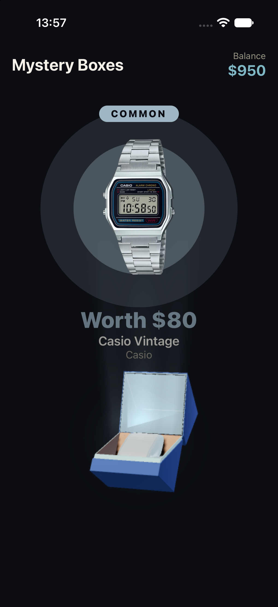
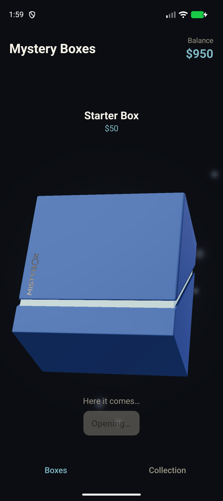

# The show around the box

Everything that happens in the 3D scene besides the box itself: the light in the seams, the light curtain, the shock waves, the sparks, the dust, the glow behind every box, the camera punch and the little physical touches. The look is the same in all three repositories; the numbers are one configuration file, [`effectsConfig.ts`](../src/flows/openingFlow/_config/effectsConfig.ts), and the maths is one pure file, [`computeSceneEffects.ts`](../src/flows/openingFlow/_facadesLogic/computeSceneEffects.ts) (unit tested, no engine in it).

Left: iOS Simulator, the light curtain and the glow inside the lid. Right: Android, the seams charging before the lid is let go, with the faint motes behind the box.

 

## Timeline of an opening

| Moment | What you see | Where |
|---|---|---|
| Box bought | The coloured trim of the seam starts to **breathe** softly in the colour of the prize. The box is now "armed". | `computeSeamIntensity` |
| Finger held on the box for 0.45 s (or *Open the box* / swipe up) | The opening starts. | `useOpeningFacade` |
| 0 – 0.8 s anticipation | The box shakes and swells, the seams light up stronger and stronger, faint motes behind the box are **drawn in** towards it, the haptic engine pulses denser and harder. | `computeSeamIntensity`, `computeDustPoint`, `ANTICIPATION_HAPTIC_PULSES_MILLISECONDS` |
| last 0.14 s | The box **holds its breath**: the shake dies away. | `computeJitterScale` |
| Lid let go | **Camera punch** (the box swells and shakes for a moment), the seams **flash**, **shock waves** and a **burst of sparks** leave the box, the **light curtain** rises. | `computeCameraPunch`, `computeRingEffect`, `computeBurstParticle`, `computeShaftEffect` |
| Lid open | The lid swings a little past the open position and **settles**. | `computeLidSettleDegrees` |
| Prize shown | The light curtain rises from the open box to the watch; the watch floats, slides against the tilt of the phone and glints. | `computeShaftEffect`, `useFacadeWatchReveal` |
| Box put away | Everything fades with the box. | `tuckProgress` in every function |

Outside an opening: a soft coloured **glow behind every box** (the colour of the box), and the boxes **sway against the direction of a fast scroll** (`stepScrollSway`).

## The better the prize, the bigger the show

| Rarity | Sparks | Shock waves | Light curtain (strength / height) | Seam and light boost | Camera punch |
|---|---|---|---|---|---|
| Common | 6 | 1 | 0.45 / 3.2 | 1.0 | 0.5 |
| Rare | 12 | 1 | 0.65 / 3.2 | 1.2 | 0.7 |
| Epic | 20 | 2 | 0.85 / 3.4 | 1.5 | 0.85 |
| Legendary | 32 | 3 | 1.0 / 3.6 | 2.0 | 1.0 |

## How it is drawn

- Three tiny shapes built in code ([`createEffectGeometries.ts`](../src/services/sceneEffects/createEffectGeometries.ts)), all flat, facing the (fixed) camera, drawn with `MeshBasicMaterial` (additive blending, no depth write): a soft **disc** (sparks, dust, glow behind a box), a thin **ring** (shock wave) and a **curtain** (the light). Pools of them are re-used; nothing is created while the app runs.
- The soft edges are **vertex alpha** (`vertexColors` with a four component `color` attribute): three.js honours it. [`applySceneEffects.ts`](../src/services/sceneEffects/applySceneEffects.ts) places and tints every object once per frame inside `useFrame`.
- The sparks, the shock waves and the light curtain are drawn **in front of the open box** so no wall of the box cuts them off; the dust and the glow are **behind** the box, so nothing ever flies through the figure.
- The coloured trim of the seam is the box model's own `Shell_Seam` accent material (`seamMaterials` of the box instance); the show makes it emissive.
- Everything is tinted with the colour of the prize (`glowColorLinear`, multiplied by the rarity boost).

## Interaction

- **Hold a finger on a bought box** for 0.45 s: it charges and opens (an alternative to swiping up).
- The haptic engine pulses along the anticipation (light → heavy).
- The watch of the reveal slides against the tilt of the phone and catches the light now and then.

## Ideas not done (on purpose)

Depth of field, vignette, colour grading and lens flare (the engine options exist but are not exposed by every binding, and every full-screen effect costs frames); iridescence and anisotropy on the box materials (not confirmed in Filament's glTF loader); a 3D collection shelf.
